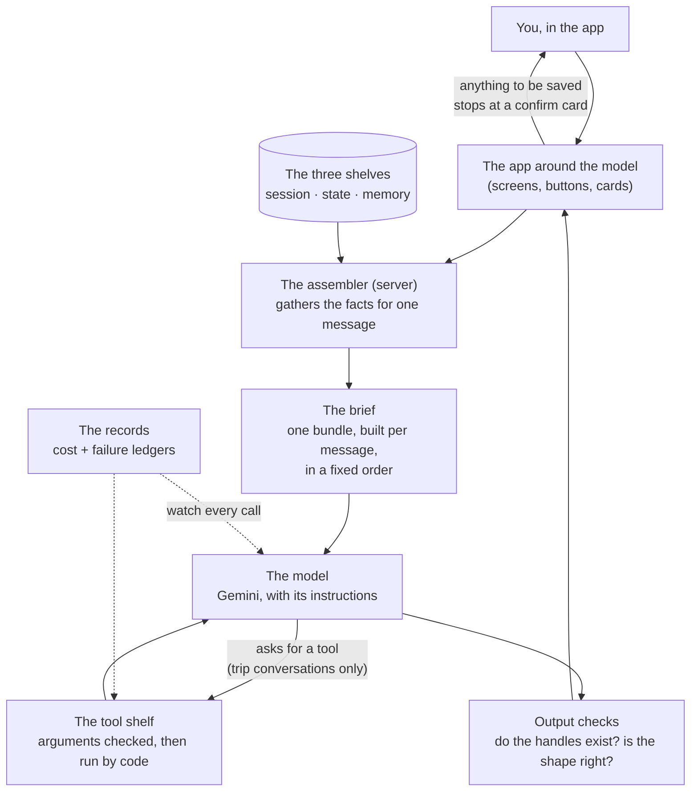
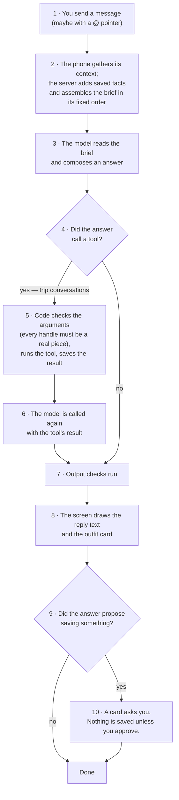
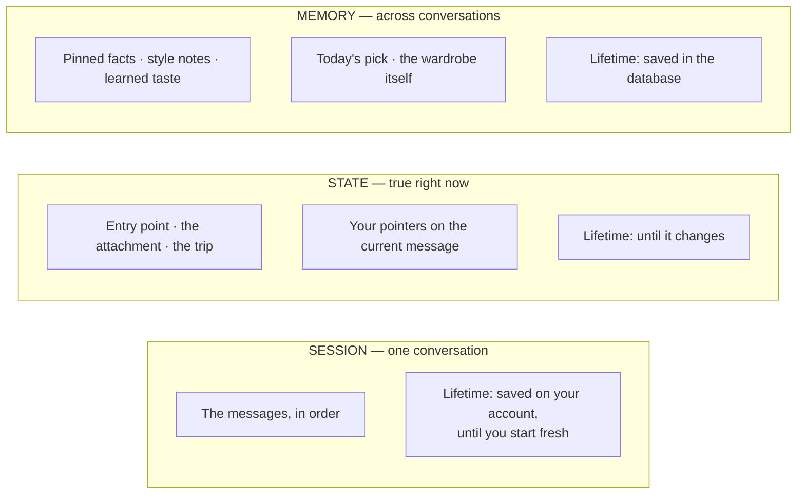

# The AI Stylist — Agent Architecture

This document describes how the Closet app's AI stylist is built: what
parts it has, how a message flows through them, what the model is shown,
what it may do, and what it remembers. It describes the **current state
only** — when the architecture changes, this document is rewritten to
match in the same commit. It is written to be shared: a reader with no
knowledge of the codebase should finish it knowing how the agent works.

Companion documents, for readers who want the working detail: the code
audit and the decisions still open live in
`docs/sprints/sprint-23/CURRENT-STATE.md` and `AUDIT.md`; the design
principles behind the architecture live in
`docs/sprints/sprint-23/AGENT-FUNDAMENTALS.md`. The records the system
keeps about itself are designed in `docs/OBSERVABILITY.md`; the data it
remembers is designed in `docs/DATA_MODEL.md` and
`docs/PERSONALIZATION.md`.

Last updated 2026-10-24.

## The system in one paragraph

The stylist is **one agent, not several**: a single AI model (Google
Gemini) that receives, for every message, a freshly assembled bundle of
facts called the **brief** — the user's wardrobe, the conversation, and
the user's saved preferences — together with standing instructions. The
model composes an outfit answer. In trip conversations it may also call
a small set of **tools** (checked actions the code runs for it, such as
revising a packing list). Everything around the model — assembling the
brief, checking the answer, saving anything — is ordinary code on a
fixed path. In the industry's terms, the stylist is an **augmented
model** (a model plus facts, tools, and memory) sitting between a
*workflow* and a free *agent*: the model composes freely, but it walks
a path the code fixed in advance.

## Words we use

| Word | What it means | Example |
|---|---|---|
| Agent | A program where an AI model does a job using context and tools, inside limits the code sets. | The stylist: reads your wardrobe facts, composes an outfit answer. |
| Workflow | Fixed code steps with model calls placed inside them; the code decides the order. | The catalogue photo analysis: photo in, fixed steps, item card out. |
| The augmented model | Anthropic's name for the basic building block of every agent: a model plus three attachments — facts it can look up, tools it can call, and memory it can read. | The stylist is one: Gemini + wardrobe facts + trip tools + saved preferences. |
| Instructions | The standing orders given to the model on every call: its job, the house rules, and the exact shape its answer must take. | "You are the stylist. Answer in this shape. Never invent a piece." |
| The brief | The bundle assembled for one model call: instructions, facts, conversation, and the new message, in a fixed order. | One brief is built per message you send. |
| Context assembly | Choosing, for one call, exactly which facts the model sees and in what order. Anthropic calls the craft *context engineering*: the model's attention is a limited budget, so every fact in the brief has to earn its place. | The server builds the brief from the phone's context plus the saved facts only it can read. |
| An entry point | A place in the app where a conversation with the stylist begins. Each entry point attaches its own context, per the table below. | The Stylist tab; the Today screen's Ask button; a trip page. |
| A handle | The short label a piece carries inside the brief (`[i3]`), so the model can point at pieces exactly, without long ids. | "Build around [i3]" in a packing list means one specific sweater. |
| A pointer | A piece or outfit you attach to a message yourself by typing @. | "@navy blazer but warmer" builds the answer around that blazer. |
| A tool | A named action the model may ask the code to run, with checked inputs. OpenAI sorts tools into *data tools* (look something up) and *action tools* (change something). All three of ours are action tools. | `updateTripPacking` replaces a trip's packing plan. |
| A pinned fact | A short fact you approved for the stylist to always remember ("I run cold", "the trip is in Tahoe"). The stylist may propose one; it is saved only when you tap Save. | Up to 20 are read into every brief. |
| The assembler | The one server function that builds every brief, for every caller, and returns the manifest beside each answer. Nothing else may gather context. | A new kind of fact is added in exactly one place, and every caller gets it. |
| The manifest | The list the assembler returns with each answer: what it actually loaded into that brief, in plain names. | "Loaded: wardrobe (69), style notes (3), pinned facts (2)." |
| The context line | The one slim display under the chat header. It renders the manifest, so what it shows is what the assembler loaded — the two cannot disagree. It opens the context sheet: every fact in play, each removable. | `Knows: Tahoe · runs cold · +2 more` |
| A thread | A saved conversation: one for general chat, one per trip, kept on your account. | You reopen the app on Tuesday; Tuesday's thread is where Monday's ended. |
| Today's pick | The outfit the app composed for you this morning. | Joins a conversation only when you tap a button that is about the pick (see the entry-point table). |
| The previous pick | The last outfit the stylist proposed in this conversation — the thing "warmer" or "more formal" changes. | You write "warmer"; the previous pick is the base that changes. |
| Style notes | Your confirmed written preferences, read into every brief. | "Never suggest skinny fits." |
| Learned taste | Scores the app quietly keeps per style word, learned from what you wear and rate. | "Streetwear" at 0.7 after repeated wears. Rules in PERSONALIZATION.md. |
| A style word | A word you name in a message ("streetwear", "cozy") that steers that answer. | It outranks learned taste for that answer (see who-wins). |
| A session | One conversation, in Google ADK's sense: the ordered history of its messages, kept together as one thing. | The general conversation; each trip has its own. |
| State | The scratchpad of facts true *right now* in a conversation: the entry point, the labels showing, the trip in play, your pointers. | Held in the page, beside the session. |
| Memory | Facts kept *across* conversations, stored in the database and read into briefs: pinned facts, style notes, learned taste, today's pick, the wardrobe itself. | The shelves diagram below shows all three kinds. |
| Checks | Code that inspects what goes into and out of the model, in layers. OpenAI's agent guide lists them as a standard part of every agent. | Dropping piece handles the model invented; refusing a packing list that names a piece twice. |
| Structured notes | Anthropic's technique for long-running agents: durable facts written as notes outside the conversation and read back in, instead of relying on the history. | Our pinned facts and style notes are exactly this — with the user as approver of each note. |

## The pictures

### The parts, and how they connect

### One turn, step by step

### The three shelves where facts live

## How the orchestration works

### The parts

| Part | Industry name | Its one job |
|---|---|---|
| The screens and cards | The host application | Everything the model is not: display, buttons, approvals. |
| `assembleContext` (server) | The context assembler | The single place every brief is built: choose the facts, order them, state which fact wins — and return the manifest of what was loaded. |
| Gemini (`gemini-3.5-flash`) | The model | Read one brief, compose one answer. |
| The trip tools | Tools (action) | Let the model revise a packing plan, suggest outfits from it, and propose pinned facts. |
| The sanitizers and validators | Checks / guardrails | Keep invented or malformed answers from reaching the screen or the database. |
| The thread store (database `chat_threads` + page cache) | The session store | Keep each conversation's whole transcript, one document per thread. |
| The database collections | The memory store | Hold facts across conversations and feed them into briefs. |
| The `ai_usage` and `error_events` ledgers | Tracing / observability | Record each call's cost and failures (OBSERVABILITY.md). |

### A turn, in words

1. You open the chat from an **entry point**. The app picks the
   conversation for it: the general conversation, or that trip's —
   and loads that thread from your account. Reopening after a gap
   (a new day, or some hours) marks the return with a divider line:
   "Continuing from Tuesday."
2. If the saved conversation is empty, the app writes the first
   message itself: a greeting — or, for a trip, a line that names
   the trip.
3. You type a message and tap send. You can attach a **pointer** by
   typing @.
4. The phone gathers the context it holds (the conversation, the
   attached picks, your pointers, the weather it measured) and sends it
   to the server.
5. The server checks every piece of that context, adds the saved facts
   only it can read (pinned facts, style notes, learned taste), and
   assembles the **brief in a fixed order**: the instructions, your
   style notes, the weather, today's pick, the previous pick, your
   pointers, a style word if you named one, your learned taste, the
   pinned facts, then the conversation and your message. The wardrobe
   travels as one line per piece, each with its handle.
6. The model answers. In a **trip conversation** it may instead call a
   tool; the code checks the tool's arguments (every handle must be a
   real piece in the wardrobe), runs it, and calls the model again with
   the result.
7. **Output checks** run before anything is drawn: handles that do not
   exist are dropped, a broken answer shape is repaired once, and some
   failures earn one silent retry with a stricter instruction.
8. The screen draws the reply text and the outfit card. The reply
   carries the **manifest**; the context line under the header
   renders it, so what the line shows is exactly what the assembler
   loaded. Every message is saved to the thread as it lands.
9. Anything the answer proposes saving — a pinned fact, a style-note
   change — stops at a **proposal card**. It is written only when you
   tap Save. Tool writes in a trip (a revised packing plan) are applied
   on the model's word, after the argument checks.

Two other callers use the same stylist without a conversation: the
**morning pick** (Today) and the **outfit composer** (the "build a look"
actions). The same assembler builds their briefs, under the same
rulebook; the bundles are smaller only because there is no conversation
and there are no pointers — not because different rules apply. One
answer, no tools.

### What each entry point attaches

Attaching is an act, not a default: context joins a conversation when
a button that is about that context is tapped — never merely because
a screen opened. Memory (pinned facts, style notes, learned taste)
is not an attachment: it applies to every brief, always.

| Entry point | Conversation | What attaches | What you see of it |
|---|---|---|---|
| Stylist tab / chat button | General | Nothing. The conversation starts clean. | The context line: memory only (wardrobe, style notes, pinned facts, weather). |
| Today screen: Ask the stylist — and "Ask about this" on the pick card inside the chat | General | Today's pick. It also becomes the base that changes build on, until this conversation has a pick of its own. | The context line names it; the context sheet can remove it. |
| Build a look around this | General | A pointer to that piece, plus text typed for you that waits unsent. | The pointer shows as a label above the typing box; removable before sending. |
| Surprise me | General | A message the app writes and sends — from that button only. Today's pick does not attach; the result is something new. | The sent message, after it is sent. |
| A trip page | That trip's | The trip, its packing list, its stored weather. Today's pick and place pins are left out on purpose. | The context line names the trip; "Leave trip" lives in the context sheet. |

### Who wins when two facts disagree

These rules are stated to the model as one block in every brief (the
PRECEDENCE block, generated from this table), above the per-feature
details:

| The disagreement | The winner | Example |
|---|---|---|
| A style note vs anything else | The style note | "Never suggest skinny fits" removes skinny fits from every pick. |
| You name a style word; your learned taste points the other way | The style word you named | You write "streetwear"; the pick follows streetwear, not your usual taste. |
| You attach a pointer; a previous pick exists | The pointer | You point at the blazer; the new outfit is built around the blazer. |
| You state weather in the chat; a pinned fact carries weather | The weather you stated | The pinned fact says Tahoe snow; you write "plans changed, I am home" — home weather rules. |
| A pinned fact carries weather; the phone measured the weather where you are | The pinned fact | You are pinned to Tahoe; the phone sits in California; Tahoe weather rules. |
| The conversation has no pick of its own yet; today's pick is attached | Today's pick becomes the base that changes build on | You open the chat and write "warmer" — today's outfit is the one that changes. |

### The tool shelf (trip conversations only)

| Tool | What it does | Checks before it runs |
|---|---|---|
| `updateTripPacking` | Replaces the trip's packing plan with a full revised plan: the pieces to pack (each with a reason) and 2–3 outfits built only from those pieces, each with a name and a tagline. Called only when you ask for packing changes. | Every handle must be a real wardrobe piece; the outfits may use only pieces in the plan; a plan that fails checking is refused with a reason the model can read, and the refusal is recorded. |
| `suggestTripOutfits` | Proposes up to 4 outfit combinations built from the pieces in the current packing plan, without changing the plan. | Only pieces in the plan may be used; same handle checking. |
| `pinContext` | Proposes a pinned fact from inside the trip conversation. | The standing approval rule: the fact is saved only when you approve it. |

In the **general conversation** the model has no callable tools. The
same kinds of outcome arrive inside its answer instead — an outfit, a
proposed pinned fact, a style-note change — and the app carries them
out after its checks. Industry systems usually pick one mechanism; this
system currently runs both, one per conversation kind.

### The shelves, in a table

| Shelf | Holds | Stored where | Lifetime | Who writes |
|---|---|---|---|---|
| Session (a thread) | The messages of one conversation — the whole transcript | Database (`chat_threads`, one document per thread) + a page cache | Until you start fresh; a trip's thread is deleted with its trip | You and the stylist, by talking |
| State | Entry point, fact labels, the current trip, pointers | Page memory | Until it changes | The app, from your taps |
| Memory | Pinned facts (at most 20) | Database | Until you delete one | The stylist proposes; you approve |
| Memory | Style notes (confirmed preferences) | Database | Until changed | You confirm each change |
| Memory | Learned taste (a score per style word) | Database | Always updating | The app, silently, from wears and ratings (PERSONALIZATION.md) |
| Memory | Today's pick | Database | One day | The app, each morning |
| Memory | The wardrobe | Database | Until you remove a piece | You, by adding pieces |

### Limits in force

| Limit | Value | Set by |
|---|---|---|
| Messages from the conversation that the model reads | The last 50, per conversation | The server; the thread itself says so, once, when it first passes 50 |
| Length of one message the model reads | 2,000 characters | The server |
| Pinned facts read into a brief | Up to 20 | The server |
| Wardrobe sent in a brief | Every piece, every time, one line each | The phone + server |
| Conversations kept after the app closes or reloads | Every thread, in full | The thread store |

## Where this sits in the industry's map

The frames below are how the leading agent builders describe their own
systems. The mapping is included so this architecture can be compared
with theirs in their words.

| Frame (source) | Their idea, in one line | This system |
|---|---|---|
| The augmented model (Anthropic, *Building Effective Agents*, 2024) | Every agent is a model plus facts, tools, and memory. Start from this block. | One augmented model, exactly. |
| Workflow vs agent (Anthropic, same) | Workflows follow code paths fixed in advance; agents direct their own steps. Use the simplest shape that works. | A hybrid: a fixed path around the call, free composition inside it, and a small tool loop in trip conversations only. |
| One agent first (OpenAI, *A Practical Guide to Building Agents*, 2025) | Grow a single agent's ability before splitting into several; splitting adds cost and confusion. | One stylist. There are no multi-agent plans. |
| Instructions + tools + model (OpenAI, same) | An agent is those three parts; most of the craft sits in the instructions and the tool shelf. | The craft sits in the assembler and the instructions. |
| Guardrails in layers (OpenAI, same) | Checks belong at entry, around tools, and on output — not in one place. | Output checks are the strongest layer; tool-argument checks exist in trip conversations; entry checks are size limits. Public-safety layers are a deliberate non-goal for a private, single-user wardrobe app. |
| Context engineering (Anthropic, *Effective Context Engineering for AI Agents*, 2025) | The brief is a budget: assemble deliberately, keep it small, order it well. | The brief is rebuilt per message in a fixed order. Two of this frame's three long-conversation techniques are in use in part: structured notes (pinned facts, style notes), and light pointers (handles + one-line summaries — the model cannot fetch more detail, so the user's @-pointers are the manual version of fetching). Deliberate summarization of long conversations is not in use: older messages fall outside the 50-message reading window, and the thread says so honestly when that first happens. |
| Session, state, memory as separate things (Google, Agent Development Kit) | A conversation, its scratchpad, and long-term memory are three different stores with three different lifetimes. | All three shelves exist, as drawn above. The session shelf is a database-backed store — ADK's production-grade session option, not the in-memory development one it replaced. |
| Model / tools / orchestration (Google, *Agents* whitepaper, 2024) | An agent system splits into the model, its tools, and the layer that runs the loop. | The component table above follows the same split: the model, the tool shelf, and the assembler + host as the orchestration layer. |

## Code pointers

As of 2026-10-24, after the UX-18 build (Sprint 23, waves W1–W5).
Server: `functions/index.js` holds the callable handlers;
`functions/stylist.js` holds the assembler (`assembleContext`, over
`buildStylistRequest`), the manifest builder (`buildManifest`), the
PRECEDENCE block, the tool declarations (`updateTripPacking`,
`suggestTripOutfits`, `pinContext`), and the checks. Client:
`public/index.html` holds the thread store (`chat_threads`), the
context line and sheet, and the state shelf. The design this build
implements is `docs/CONTEXT-MODEL.md`; the audit trail behind it is
`docs/sprints/sprint-23/AUDIT.md`.
