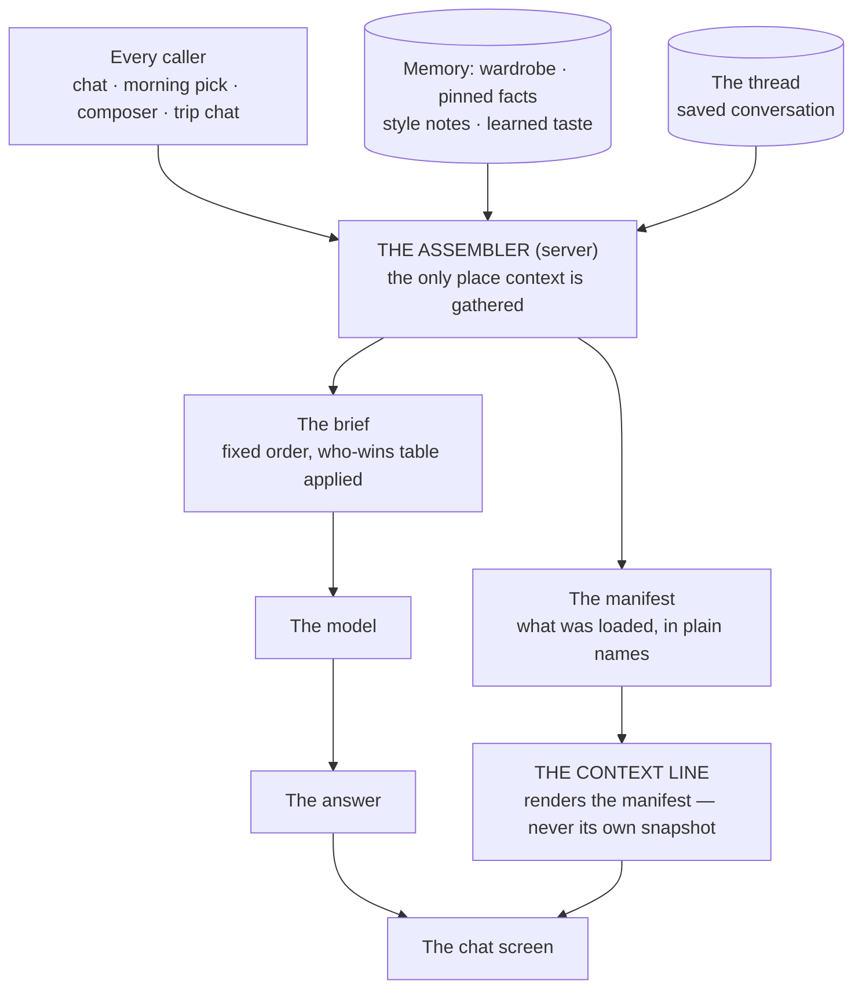
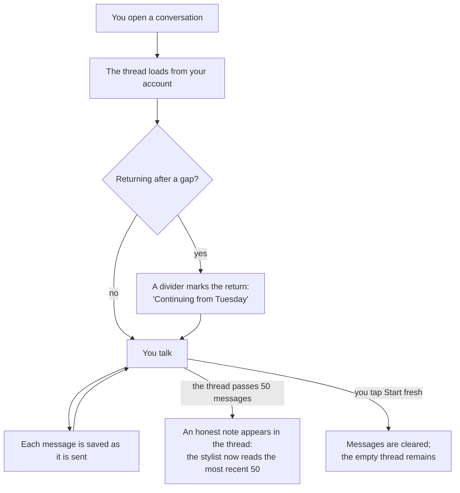

# The Context Model — How the Stylist Loads, Shows, and Keeps Context

This document is the build spec for the stylist overhaul (UX-18,
Sprint 23): the design that comes out of the sit-down of 2026-10-24.
It states the target — how context is loaded, displayed, saved, and
limited — and the waves that build it. The decisions behind it are
recorded in `docs/sprints/sprint-23/CURRENT-STATE.md`; the evidence is
in `docs/sprints/sprint-23/AUDIT.md`; the principles are in
`docs/sprints/sprint-23/AGENT-FUNDAMENTALS.md`. As each wave ships,
`docs/AGENT-ARCHITECTURE.md` (the living description of the current
state) is updated in the same commit, and the wave is marked done
here.

**Build status (2026-10-24): all five waves are built, deployed, and
headlessly verified** (tests 339/339; the callable returns the
manifest live; thread read/write/delete confirmed against the live
rules). The founder's phone test is the ship gate. Two recorded
deviations from the text below: (1) guests — this app's guests are
anonymous-auth users with real account ids, so their threads are
stored server-side under that id exactly like a signed-in user's;
there is no device-only tier and no merge step (an upgrade that
keeps the account id keeps the threads). (2) Start fresh lives in
the context sheet, not a separate chat menu — one surface for
everything about the conversation's context.

The whole design is one sentence: **there is one way context is
loaded, one display of what was loaded, one rulebook for every
caller, and conversations are kept.** Everything below is that
sentence made concrete.

## Words we use

The product words (the brief, a pointer, a pinned fact, today's pick,
style notes, learned taste) carry the meanings given in
`docs/AGENT-ARCHITECTURE.md`. New words for this design:

| Word | What it means | Example |
|---|---|---|
| The assembler | The one server function that builds every brief, for every caller — chat, the morning pick, the composer. Nothing else may gather context. | A new fact type is added in exactly one place, and every caller gets it. |
| The manifest | The list the assembler returns beside the answer: what it actually loaded into this brief, in plain names. | "Loaded: wardrobe (69), style notes (3), pinned facts (2), today's pick." |
| The context line | The one slim display under the chat header. It renders the manifest: the first few facts in play plus a count, and opens the full list when tapped. | `Knows: Tahoe · runs cold · +2 more` |
| The context sheet | The full list the context line opens: every fact in play, each with its remove control where removal applies. | A pinned fact's × deletes the fact; a pointer's × removes it for this message only. |
| A thread | A saved conversation. Threads are keyed the way conversations already are: one general thread, one per trip. There is no list of threads and no titles. | You reopen the app on Tuesday; the general thread is where you left it on Monday. |
| Start fresh | The action that clears the current thread's messages and begins again. Always reachable from inside the chat. | The escape hatch that makes saving feel safe. |
| A built-in action | A button whose label is itself an instruction, carrying its own prompt. It may send that prompt — only from that button. | Surprise me. |

## The pictures

### One loader, one display

### A thread's life

## The target rules

### Loading — one assembler, one rulebook

| Rule | Detail |
|---|---|
| Every brief is built by the assembler. | Chat (general and trip), the morning pick, and the outfit composer all call it. The client no longer assembles context bundles of its own; it sends the message, the pointers, and which conversation it belongs to. |
| One rulebook. | The who-wins table (CURRENT-STATE.md) is the precedence rule for every caller, and the stylist's instructions are generated to match it. A fact behaves the same way no matter which door the user came through. |
| Callers differ only in what exists. | The morning pick and the composer have no conversation and no pointers; their briefs are smaller because those shelves are empty, not because different rules apply. |
| The iteration rule lives here. | "Which outfit are we changing" is resolved by the assembler from the thread and the manifest (the previous pick in this thread, else an attached pick, else none) — in one place, tested once. |
| Every answer carries its manifest. | The response includes the manifest; the client renders the context line from it. A caller with no screen (the morning pick) still produces a manifest, kept with its records. |

### Attaching — an act, not a default

| Entry point | What attaches | Why |
|---|---|---|
| Stylist tab / chat button | Nothing beyond memory (pinned facts, style notes, learned taste always apply — they are memory, not attachments). Today's pick does **not** attach. | Decision 1: a general session starts clean. |
| Today screen — ask about the pick | Today's pick attaches. | The button is about the pick; tapping it is the act. |
| Build a look around this | A pointer to that piece; text typed for the user, unsent. | The piece is the subject the user chose; the words wait for their send tap (decision 8). |
| Surprise me | Its built-in prompt sends, from its button only. Today's pick does **not** attach; the result is something new. | Decision 8, refined: a button whose label is the instruction may fire it — from that button, never from merely opening a surface. |
| A trip page | The trip: its packing and stored weather. Not today's pick, not place pins. | A trip conversation is about the trip (the standing context-scoping rule). |

### Displaying — the context line

| Rule | Detail |
|---|---|
| One display. | The context line is the only display of what the stylist knows in a conversation. It renders the latest manifest. |
| Contents, in order. | Attached items first (today's pick, pointers), then the trip (in a trip conversation), then pinned facts, then a standing tail: style notes and learned taste are summarized as counts, not listed ("style notes · taste on") — they are memory, always on, and listing them per-message is noise. |
| Overflow. | The line shows the first three entries and "+N more". It never wraps to a second line. |
| The sheet. | Tapping the line opens the context sheet: every entry, in the same order, with a remove control where one applies — an attachment's × detaches it; a pinned fact's × deletes the fact (with the standard confirm); memory entries (style notes, learned taste) show as on, with a link to their settings, not a ×. |
| The top outfit card is demoted. | It is no longer a context display. Where it appears (leading the stylist sheet from Today), it is a plain pick card: photo, name, Wear / Another / Ask — the Ask being the button that attaches it (see Attaching). |
| Nothing attached, nothing to show. | In a clean general session the line reads "Fresh conversation — the stylist knows your wardrobe, style notes, and pinned facts" only until the first answer's manifest replaces it; if the manifest is memory-only, the line shows the memory summary. The line is never absent — its presence is the honesty mechanism. |

### Keeping — threads

| Rule | Detail |
|---|---|
| Storage. | One record per thread key (`general`, `trip:<tripId>`) under the user's account: the messages in order, each with its role, text, outfit card data where present, and timestamp; plus `updatedAt`. Written as messages are sent and received; loaded when the conversation opens. |
| The whole transcript is kept. | Storage is not the reading window: the full thread is stored; the assembler reads only the window (below). |
| No thread furniture. | No thread list, no titles, no new-thread button, no search. The two conversation kinds the app already has are the whole model. |
| Trip threads retire with their trip. | Deleting a trip deletes its thread. |
| Start fresh. | Clears the current thread's messages (after the standard confirm), keeps the key. Available in every conversation. |
| Guests. | Guests here are anonymous-auth users with real account ids, so their threads are stored on the account like anyone's (see the build-status note above). |

### Intuitive clarity — how the user always knows what is going on

The founder's requirement for decision 6: persistence must explain
itself in use, without a tour. Four mechanisms, all cheap:

1. **The return divider.** Reopening a conversation after a gap (a
   new day, or more than a few hours) shows a divider in the
   transcript: "Continuing from Tuesday." The user sees one continuing
   conversation, not a mysteriously pre-filled screen.
2. **Start fresh is always visible** — in the chat's menu, labeled in
   words. Its presence teaches the model: this continues until you
   restart it.
3. **A one-time notice.** The first time a conversation is saved under
   this system, one line appears in the thread: "Conversations are
   saved now — this one will be here when you come back. Start fresh
   any time from the menu." Once, never again.
4. **The window note** (decision 7) appears in the thread at the
   moment it first becomes true, and the context line's sheet always
   states the window plainly ("The stylist reads the most recent 50
   messages of this conversation").

The founder will use the app organically and feed back; these four
are v1 of the clarity design, expected to be tuned, not treated as
final.

### The reading window

| Rule | Detail |
|---|---|
| Size. | The assembler reads the **last 50 messages of the current conversation**. Per conversation — not per day, not per app-open. A new trip thread starts with a fresh window because it is a new conversation. |
| Honesty. | When a thread first passes 50 messages, a note is added to the thread (see Clarity). The count is also visible in the context sheet at any time. |
| No summarizing (for now). | Deliberately deferred (decision 7): cheap to run, narrow benefit at this window size. The note covers the expectation honestly. Revisit trigger: the founder hits the limit in real use and feels the loss. |

### Writes and proposals

Unchanged from the current design, now uniform across callers: the
model proposes; the user approves; nothing is saved on the model's
word alone except checked trip-tool writes (packing), per the
architecture document. The two proposal mechanisms (trip tools vs
answer fields) are unified under the assembler wave as one registry:
every model-initiated action is declared in one place, with its
arguments and its check, whether it travels as a tool call or as an
answer field.

## Build waves

Each wave is its own card when pulled: behavior-preserving where it
claims to be, phone-validated before it is called done, and
`docs/AGENT-ARCHITECTURE.md` updated in the same commit.

| Wave | Scope | Acceptance, in plain terms |
|---|---|---|---|
| **Status** | **W1–W5 all built 2026-10-24** (commits `3fa5fd8`, `b22eb63`, `2c1b83f`, `67554ce`, `bd93f27` on main). | Phone validation by the founder is the remaining gate. |
|---|---|---|
| **W1 — One assembler + the manifest** | Server: all four callers route through `buildStylistRequest`'s successor; the client stops assembling its own context; every response carries a manifest. No visible change intended. | For the same conversation, every caller's brief follows the same order and who-wins table; tests assert the manifest matches the brief's contents; the audit's four call-site shapes are gone. |
| **W2 — Attach and start rules** | Decision 1 + 8: the pick attaches only from its button; auto-attach and the re-seeding on open are removed; Surprise me fires only from its button; seeded text never auto-sends. | Opening the stylist cold, the context line shows no pick. Asking from Today attaches it. Surprise me does nothing until tapped, then sends its own prompt. |
| **W3 — The context line and sheet** | Decisions 2 + 4: the line (rendered from the manifest), the sheet with remove controls, the top card demoted to a plain pick card, the old label renderers deleted. | One display exists; removing its parts works from the sheet; the line and the assembler's manifest cannot disagree (the line *is* the manifest). |
| **W4 — Threads** | Decision 6: thread storage, load on open, save on send, the return divider, Start fresh, the one-time notice, guest merge. PC-32 is absorbed by this wave. | Kill and reopen the app mid-conversation: the thread is intact on phone and desktop. Delete a trip: its thread is gone. Start fresh: empty thread, same key. |
| **W5 — The window and the written rules** | Decision 7 + 5 + 9: the window becomes 50 everywhere (constant in one place); the window note; the who-wins table written into the instructions from one source; the morning pick and composer confirmed on the assembler (any stragglers from W1 land here). PC-33's pin rules and PC-38/PC-41/PC-45 are re-examined against the finished model at this wave's close, per the sprint plan. | A 60-message thread shows the note once and reads 50; the instructions' precedence text is generated from the same table the docs carry. |

## What this design deliberately does not do

- **No multi-agent anything, no planning loop** — per
  AGENT-FUNDAMENTALS.md's NOT-importing list.
- **No thread product** — no list, titles, or search (decision 6's
  boundary).
- **No summarizing yet** — decision 7's deferral, with its revisit
  trigger written above.
- **No change to what the model is** — Gemini, one call per turn (two
  on a trip tool round-trip), as the architecture document describes.

## Code pointers

As of 2026-10-24, pre-build. Client: `public/index.html` — `sendChat`,
`openChat`, `openTripChat`, `seedTodayChip` / `renderTodayChip`,
`renderChatTodayStrip`, `renderPinChip`, `composerPick`,
`generateTodayPick`, `callAskStylist`. Server: `functions/index.js`
(the askStylist handler, ~lines 200–295), `functions/stylist.js` —
`buildStylistRequest` (the assembler-to-be, ~line 687), the tool
declarations (~lines 479–585). Full evidence:
`docs/sprints/sprint-23/AUDIT.md`.
