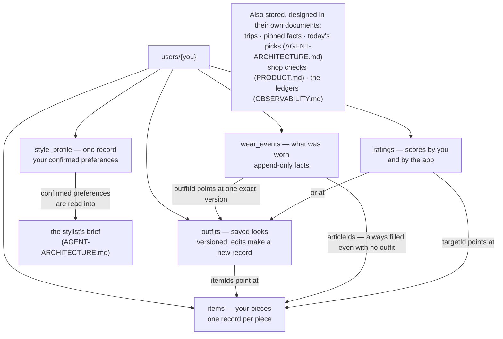
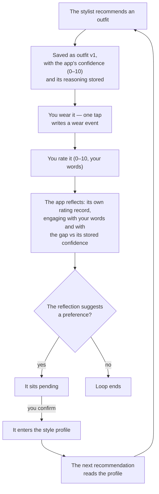
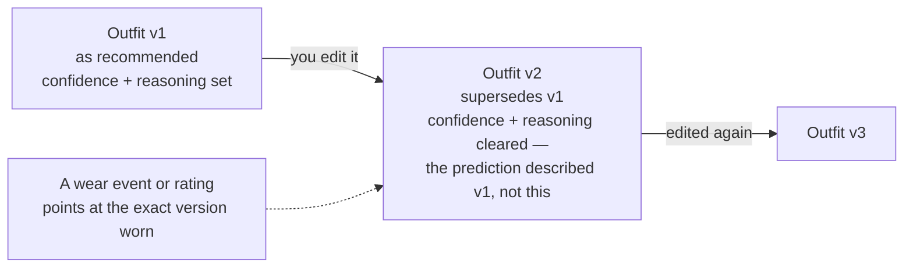

# The Data Model — What the App Stores, and the Rules It Follows

This document is the design for every record the Closet app keeps: your
pieces, your outfits, what you wore, how you rated it, and what the app
has learned about your taste. It was designed ahead of need — pieces
first (v2, 2026-10-14), then outfits, wear, and learning (v3,
2026-10-15) — so the app would never need a drastic migration later.
It is a living document: when a collection or a rule changes, this
document changes in the same commit.

One idea runs through the whole model, set by the founder on
2026-10-14: **the AI proposes, you dispose.** Anything you confirmed
outranks anything the AI guessed, and the data is shaped so that rule
can be enforced in code, not just promised.

## Words we use

| Word | What it means | Example |
|---|---|---|
| An item | One piece of clothing in your wardrobe. (The app calls it a "piece" on screen; the stored record is the item.) | The navy crewneck sweater. |
| Provenance (the `source` field) | A note on a value saying who wrote it: you, or the AI. Any field both could write carries one. | The sweater's color "rust" has `source: "user"` — the AI may never overwrite it. |
| The palette | An item's list of up to 3 colors, each a plain word plus, when known, a display hex. One entry is marked primary: the item's main color. | Navy (primary), cream, rust. |
| A color family | The fixed list of about 30 standard color names the app reasons with, so near-identical words count as one color. Defined in the palette code. | "Navy" and "midnight blue" are the same family. |
| A brand key | The grouping form of a brand name: lowercased, spaces tidied, sub-lines removed. Used for grouping and filtering; the name you see is never rewritten. | "Uniqlo UT" is stored as brand "Uniqlo", key `uniqlo`. "H&M" never becomes "H&m". |
| The raw cache (the `ai` object) | The last AI analysis of an item, kept exactly as the model returned it, separate from the fields you can edit. | If you fix the AI's fabric guess, the original guess still sits in the cache for comparison. |
| An outfit | A set of items assembled for an occasion, saved as its own record that points at the items by id. | "Rainy-day office look": 4 item ids, a name, an occasion. |
| A version | One saved state of an outfit. Editing an outfit creates a new version instead of changing the old one. Versions of the same outfit share a `versionGroup` id. | The look as first recommended (v1), and your edited variant (v2) — both kept. |
| A name snapshot | Item names copied into the outfit and wear records at save time, so the record still reads correctly if an item is later deleted. | A deleted sweater's outfit still shows "navy crewneck" in its list. |
| A wear event | The record that clothes were actually worn: when, which items, for what. A fact — it happened. | "Wore the rainy-day look, Tue Oct 20, felt overdressed." |
| A rating | A 0–10 score on an item or an outfit, written by you or by the app. The two sides are two separate records. | Your 8 on the look; the app's own reflection rating beside it. |
| The style profile | One record holding your confirmed preferences as short written statements. This is where "the stylist learns you" physically lives. | "Prefers high-contrast outfits." |
| A pending suggestion | A preference the app proposed that has no force until you confirm it. Unconfirmed suggestions never reach the stylist. | The app suggests "likes looser fits" after a rating; you tap confirm, or it stays inert. |
| Lazy migration | Old records are upgraded when they are next saved, not by a mass rewrite script. Code reads the new field when present and falls back to the old one when not. | A v1 item with only the old single `color` still displays fine until its next edit. |
| A fact vs a thing | Wear events and ratings are *facts* (things that happened; never edited by code). Items and outfits are *things* (they can gain new versions). Statistics are always computed from facts at read time — never stored as counters that can go stale. | "Worn 47 times" is counted from wear events every time it is shown. |

## The pictures

### The collections, and how they point at each other



### The learning loop the model exists to close



### Outfit versions



## How it works

1. **A piece arrives.** The AI analyzes the photo and fills the item's
   fields as suggestions: name, category, palette, pattern, fit, fabric
   guess, formality, warmth, brand. Its raw answer is also kept, whole,
   in the raw cache. Every suggested field is yours to edit.
2. **Your edits outrank the AI, permanently.** Fields carry provenance.
   A later AI re-run may add or replace only AI-written values; a value
   you set is untouchable.
3. **The stylist recommends.** Its answer names pieces by their exact
   names; the server maps names back to item ids, drops any that do not
   match, and returns no outfit at all if fewer than 2 ids check out —
   you then see a text reply with no Save button. Matching is enforced
   by the server, never trusted from the model.
4. **Saving makes outfit v1**, with the app's confidence and reasoning
   stored beside the pieces. The prediction is stored because the
   prized number later — predicted vs actual — cannot be computed if
   only the outcome is kept.
5. **Wearing is one tap** ("I wore this", on the chat card and in
   history, no form). It writes a wear event: the items (always, even
   without a saved outfit), the outfit version if there is one, and the
   *actual* occasion — which may differ from the outfit's *intended*
   occasion. That disagreement is itself signal, so the two are
   separate fields on purpose.
6. **Rating writes two records at most.** Yours first (written directly
   by the app; it stands even if everything else fails). Then the app
   reflects: it reads the outfit, the items, and your style profile,
   and writes its own rating — a reflection in words, plus at most one
   suggested preference.
7. **Learning lands only on your confirmation.** A suggested preference
   sits pending. Confirmed, it enters the style profile and is read
   into every later stylist brief. Unconfirmed, it has no effect, ever.
8. **Statistics are derived, never stored.** Wear counts, most-worn and
   never-worn lists, and rating summaries are computed from the wear
   events and ratings each time they are shown. There are no cached
   counters to drift out of truth.
9. **Old records upgrade lazily.** Code writes the newest shape on
   every save and reads with a fallback to the older shape. In
   practice the last v1 color records were normalized on 2026-10-24;
   the fallback read stays, so nothing old can break.

## Rules in tables

### The five standing principles

| # | Rule | What it means in practice |
|---|---|---|
| 1 | The AI suggests; you decide. | Every AI-filled field is editable. A re-run never modifies or deletes anything you set. |
| 2 | Provenance is data. | Anything with two possible authors records its `source`. This is what makes rule 1 enforceable in code. |
| 3 | Changes are additive. | New fields are added; old reads fall back. No mass migrations, no backfill scripts at personal scale. |
| 4 | Ids are the join keys. | An item's record id is permanent. Outfits and wear point at ids; nothing embeds what belongs elsewhere. |
| 5 | Facts are append-only. | Wear events and ratings are never edited by code. You may delete your own history; nothing is silently rewritten. |

### The item record (`users/{you}/items/{itemId}`)

| Field | Type | Notes |
|---|---|---|
| `name` | text | AI-suggested at upload; yours once confirmed |
| `category` | fixed list | Same authority rule |
| `colors` | up to 3 entries | The palette — see its own table below. Replaces the v1 single `color`. |
| `pattern`, `fit`, `fabricGuess`, `formality`, `warmth` | text / scale | AI-filled at upload, top-level and editable (moved out of the raw cache in v2) |
| `brand` | text, or nothing | Optional; empty means unknown. The AI tries best-effort from labels and logos. For organizing and filtering — it does not affect outfit harmony. |
| `brandKey` | text, or nothing | The grouping key, computed when the brand is set: server-side at upload, in the app on your edits |
| `imageUrl` / `storagePath` | text | Cover photo shortcuts |
| `photos` | up to 4 {url, storagePath} | The first photo is the cover |
| `createdAt` | timestamp | |
| `ai` | object | The raw cache — see below |

One palette entry:

```js
{ name: "navy",  family: "navy", hex: "#1f2a44", source: "ai",   primary: true  }
{ name: "cream", family: "cream", hex: null,     source: "ai",   primary: false }
{ name: "rust",  family: "rust",  hex: "#a44a2a", source: "user", primary: false }
```

- `name` is the plain word — what recommendations reason over ("the
  yellow socks match the yellow dots"). `hex` is set when a human picks
  from the color picker; AI entries may leave it empty.
- `family` is the standard name from the fixed palette list. For AI
  entries the prompt constrains it, so family equals name; for your
  entries it is resolved by nearest hex. Old free-text AI names map
  through an alias list for analysis. Reasoning uses `family` — a
  stable vocabulary.
- `primary` marks the display and search color (the old v1 `color`
  field's job).

The raw cache (`ai` object) keeps the last analysis whole: the raw
suggestion, plus `modelVersion` (which model), `analyzedAt` (when), and
`photoIds` (which photos were analyzed — the hook for a future
multi-photo "garment model"; the only concession that idea gets today).

### Decisions about color and brand, with the reasons

| Decision | Why | The alternative rejected |
|---|---|---|
| Store both the word and the hex; each reader uses what suits it. The recommender reasons over words; the screen renders hex. | Models think in language: "navy" carries matching meaning (goes with white, cream, tan); a hex code is opaque to them. Research checked 2026-10-14 agrees: ColorGPT (arXiv, 2025) found name + hex beats either alone for model color tasks; NumColor showed models cannot parse hex natively. Fashion apps do the same: compute in pixel space, reason over named palettes. | Hex-only (unreadable to the model) or word-only (too imprecise to display). |
| Shade-precise matching, if ever needed, happens in code and reaches the model as words. | Hue arithmetic (a complement is hue + 180°) is exact in code and guesswork in a model. The model never parses hex directly. | Asking the model to compare hex codes. |
| The AI returns the parent brand; sub-lines are stripped by instruction. | "Uniqlo" and "Uniqlo UT" are one brand for grouping. Display casing is never normalized. | Treating every sub-line as its own brand; or lowercasing display names ("H&m"). |
| No AI re-run when photos are added, removed, or re-covered. | The analysis describes the garment, not the photo; all photos show the same article. Verified in code: photo changes rewrite only the `photos` list and never touch the cache. Stale only if every photo were swapped for a different garment — fixed by editing. | Re-analyzing on every photo change (cost, churn, and it would fight rule 1). |

### The outfit record (`users/{you}/outfits/{outfitId}`)

| Field | Type | Notes |
|---|---|---|
| `versionGroup` | id | Stable across versions of "the same outfit" (in v1 of this design it equals the first record's id) |
| `version` | number | 1, 2, 3… |
| `supersedes` | id, or nothing | The previous version's record id; empty on v1 |
| `itemIds` | id list | The pieces — the stable join key |
| `itemNames` | text list | The name snapshot, parallel to `itemIds` |
| `source` | `stylist` or `manual` | Where the outfit came from; kept across versions |
| `name` | text | Yours to edit |
| `occasion` | text, optional | The *intent* — what it was assembled for |
| `weather` | text, optional | As given at recommendation time |
| `appConfidence` | number 0–10, optional | The app's prediction. Set on stylist-made v1; cleared when you edit (the app did not predict your variant) |
| `appReasoning` | text, optional | Why the app picked it; same clearing rule |
| `favorite` | yes/no | Copied forward to new versions — behaves as a group-level mark |
| `createdAt` | timestamp | Of this version |

History shows the latest version per group (grouped in the app; fine at
personal scale).

### The wear event record (`users/{you}/wear_events/{eventId}`)

| Field | Type | Notes |
|---|---|---|
| `wornAt` | timestamp | When it was worn; defaults to now, adjustable by you |
| `articleIds` | id list | The ground truth — always filled, even when no outfit was saved |
| `articleNames` | text list | The name snapshot |
| `outfitId` | id, or nothing | Empty when wear was logged without a saved outfit |
| `occasion` | text, optional | The *actual* occasion — deliberately separate from the outfit's intent |
| `note` | text, optional | Your words: "felt overdressed" |
| `createdAt` | timestamp | When logged (differs from `wornAt` on backfill) |

Per-item counts read `articleIds` directly — the database cannot join,
so stats never resolve through outfits.

### The rating record (`users/{you}/ratings/{ratingId}`)

| Field | Type | Notes |
|---|---|---|
| `targetKind` | `article` or `outfit` | One mechanism, two targets |
| `targetId` | id | |
| `wearEventId` | id, optional | Which wear is being rated, when an outfit is worn repeatedly |
| `rater` | `user` or `app` | The two sides are literally two records |
| `score` | number 0–10 | |
| `note` | text, optional | Your words, or the app's reflection text |
| `suggestedPreference` | text, optional | App ratings only; pending until you confirm it |
| `createdAt` | timestamp | |

Scores are never compared raw across the two raters: your 6 and the
app's 6 mean different things. The screen labels them ("your rating"
vs "app confidence") and treats the gap as information, not error.

### The style profile record (`users/{you}/style_profile/{you}`)

| Field | Type | Notes |
|---|---|---|
| `preferences` | list of {text, source, createdAt} | Your confirmed preferences. Cap 50; when pruning is needed, the oldest app-sourced entries go first |
| `updatedAt` | timestamp | |

This record is the stylist's long-term memory of your taste — distinct
from the learned taste scores, which are a separate mechanism with
their own document (PERSONALIZATION.md).

### Checked numbers (2026-10-14)

AI cost is not a design constraint at this scale: describing one piece
cost about $0.001 (2,515 tokens on the live test); a whole-wardrobe
outfit chat about $0.005, text only. Current per-call costs are tracked
in OBSERVABILITY.md.

## What is deliberately not in this model

| Not here | Status |
|---|---|
| Embeddings / vector fields on items | Deferred on research (2026-10-06). Search and matching work on words and fields today. |
| Multi-photo AI analysis (a "garment model" built from all photos) | An inbox idea (2026-10-14). The raw cache's `photoIds` is its only hook. |
| Offline support | The app has none; failures show the plain error. A product decision, not an oversight. |
| Push nudges ("what should I wear today?") | Needed the loop first; the loop now exists, so this is a product call, not a model gap. |

## Known limits and reserved designs

- **Silent downvotes are recorded as an idea, not yet consumed.**
  "Recommended but never worn within 14 days" is a signal the data
  already generates. The design reserves it; no code reads it yet.
- **Edited outfits are not re-scored.** When you edit a version, its
  stored prediction clears (correctly — it described the original). The
  app does not yet produce a fresh prediction for your variant; that is
  a reserved future cut.
- **Wear logging started outfit-centered.** The wear record always
  carries the item list, so per-item statistics work either way;
  logging wear with no outfit at all was recorded in the v3 session as
  a fast follow *if wanted* — check `docs/SHIPPED.md` before treating
  its state as settled.
- **This document covers the wardrobe core.** Trips, pinned facts,
  today's picks, shop checks, and the observability ledgers are
  designed in their own documents (see the map in the pictures); they
  follow the same five principles.

## Decisions still open

None outstanding in the model itself. The reserved items above (silent
downvotes, re-scoring edited outfits) become decisions when a sprint
pulls them; each would be designed here first, in the open, before
code.

## Code pointers

As of the v2/v3 designs (2026-10-14 / 2026-10-15), with the model since
built and amended in place.

- The palette list and family resolution: `functions/palette.js`,
  mirrored for the app in `public/js/palette.js`.
- Item analysis and the raw cache: the `describeItem` function;
  brand-key computation at upload (server) and on brand edit (app).
- The stylist contract (names in, ids validated, outfit or nothing):
  `functions/stylist.js` and the `askStylist` handler in
  `functions/index.js`.
- Reflection: the `reflectOutfit` function — your rating is written by
  the app first; the function's failure never blocks it.
- The collections: `items`, `outfits`, `wear_events`, `ratings`,
  `style_profile`, all under `users/{you}/` in Firestore.
- Implementation cuts: PC-8 (palette + item model v2), PC-10 (the
  conversational loop that satisfied v3's condition). Records in
  `docs/SHIPPED.md`.
