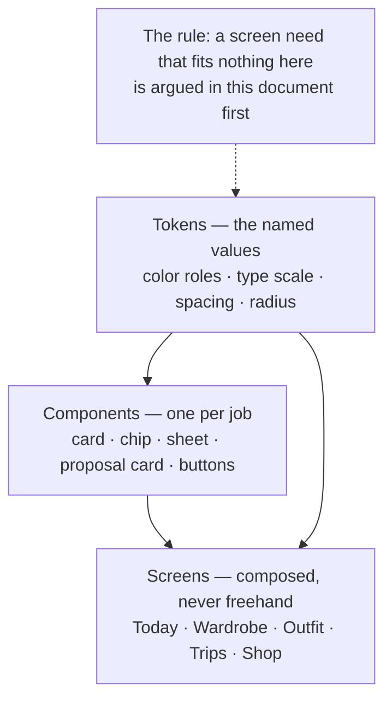
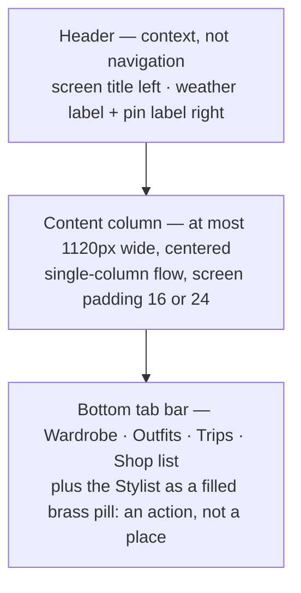
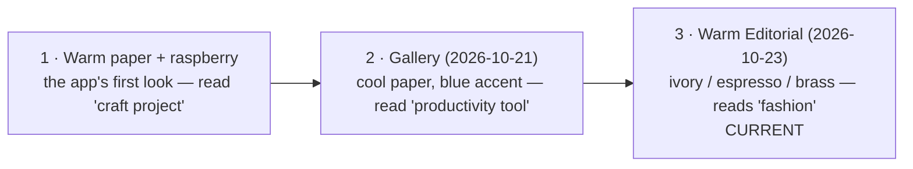

# Design — How the Closet App Looks, and Why

This document is the design system: the single source for how the app
looks and behaves visually. New or re-skinned screens are built from the
values and components defined here — nothing freehand. If a screen needs
something this document does not allow, the change is argued here first,
in the open, and the document is edited before the code is. A quiet
one-off in code is a defect.

The current identity is **Warm Editorial** (decided 2026-10-23, §10 of
the old draft): warm ivory and espresso tones, brass as the one accent,
serif type for the moments that matter. It replaced the "Gallery"
identity after only two days — cheaply, because every color in the app
is a named value that can be swapped in one place. All five build waves
of Warm Editorial shipped on 2026-10-23. Design decisions here are
numbered (D1–D12, A1–A5) with the reason and the rejected alternative,
so a future reader can re-argue them intelligently instead of starting
over.

Drafted in Sprint 18 from a full inventory of the app, put through
three recorded critique rounds (log:
`docs/sprints/sprint-18/DESIGN-CRITIQUES.md`), direction approved by
the founder 2026-10-21, then amended under the founder's design
delegation of 2026-10-23 ("make all the decisions until I'm happy with
it") — with his phone as the verdict on every wave.

## Words we use

| Word | What it means | Example |
|---|---|---|
| A token | A named value the code uses instead of a raw number or color. Change the value in one place and every screen follows. | The color `--accent` is a token; the brass hex lives only in its definition. |
| A role | What a token is *for*. Colors are named by role, never by appearance. | `--paper` means "a raised surface" — ivory in light mode, dark brown in dark mode. |
| Chrome | The app's own frame: bars, buttons, labels. The opposite of *content*, which is your clothes. | The tab bar is chrome. A sweater photo is content. |
| A component | A reusable piece of screen with one job, defined once here and composed everywhere. | There is exactly one chip component; weather, pins, and shop status are its variants. |
| A sheet | A panel that rises from the bottom edge (or docks at the side on wide screens) holding choices or a focused task. | The stylist conversation lives in a sheet. |
| A dialog | A small centered box, reserved for confirming something destructive. | "Delete this piece?" |
| The proposal card | The one card shape used whenever the AI asks to remember, create, or change something. Same shape every time, so you learn it once: *this shape means the call is mine.* | "Remember this as your current location?" with Save and Dismiss. |
| A masthead | The composed headline block of a named outfit: a small label line, the look's name in serif, an italic one-line tagline, then the pieces. | "Today's feature — *Rain-Ready Layers* — for the walk to the station." |
| A skeleton | A grey shimmering placeholder shaped like the content that is coming, shown while it loads. | A grid of tile-shaped blocks before your wardrobe appears. |
| An eyebrow | The small, capital, letterspaced label above a title. | "TODAY'S FEATURE" above a look name. |
| Reduced motion | A system setting some people enable to limit animation. The app honors it: travel becomes a short fade. | A sheet fades in instead of rising. |
| Cutouts | Photos with the background removed, so a piece floats on the card's surface. | The category wall's hero pieces (PC-34 renders). |

## The pictures

### How the system is built: values → components → screens

### One screen's anatomy

### A sheet's life (the one motion system, UX-15)

```mermaid
stateDiagram-v2
    [*] --> Closed
    Closed --> Open: tap its opener
    Open --> Closing: backdrop tap
    Open --> Closing: close control
    Open --> Closing: Esc (topmost first)
    Open --> Closing: swipe down from the head (sheets + phone chat)
    Closing --> Closed: motion ends — work inside is never destroyed by a dismissal
    Open --> Open: a second sheet stacks above; Esc closes the top one first
```

### The three identities, in order

## How a screen gets built

1. **Start from the tokens.** Every color, size, space, and corner comes
   from the tables below, by role name. A raw hex or an off-scale number
   in screen code does not merge.
2. **Compose components; do not re-derive them.** If two features need a
   card, both use *the* card. A genuinely new need becomes a new
   component here first.
3. **Lay out by the grammar.** Content column, header as context, tab bar
   at the bottom, sheets for choices, dialogs only for destructive
   confirms.
4. **Apply the motion system.** Entrances and state changes animate on
   the standard timings; data never animates in.
5. **Check the floors.** Touch targets, contrast, visible focus,
   reduced-motion behavior — the accessibility table is non-negotiable.
6. **The founder's phone is the verdict.** Server checks and previews
   are not verification; a wave is done when it has been used on the
   phone.

## Rules in tables

### The six principles

| # | Principle | In practice |
|---|---|---|
| 1 | Photo-first. The clothes are the content; the interface is the frame. | Neutral surfaces and restrained color, so a rack of real photos reads like a lookbook, not a database. Garment colors in photos are content, never UI color. |
| 2 | Morning-fast. The core job happens half-awake, one thumb, in under 30 seconds. | Every screen answers "how many taps to the thing I came for?" — and the answer is small. |
| 3 | Editorial, not dashboard. | Paper tones, serif moments, generous whitespace. A magazine that happens to be software. |
| 4 | One component per job. | Consistency is what "designed" means to the eye. Two features needing a card use the same card. |
| 5 | Quiet AI. | Picks, proposals, and scores wear the product's clothes, not a chatbot skin. The one exception is the proposal card, deliberately recognizable — trust needs a consistent shape. |
| 6 | Spec only what the stack can do. | This system is buildable in the current single-file web client. Anything needing a framework waits for the framework decision. |

### Color — the live table (Warm Editorial)

Code refers to roles only. The hexes live in exactly two places: one
`:root` block for light, one for dark. Dark is designed first — the
founder's default is dark, so espresso *is* the product and ivory is
its sibling. Brass (the accent) is for fills, large text, and graphic
moments; small accent *text* uses `--accent-dark` (at least 5.9:1 on
ivory). Nothing wears the accent except actions and things needing
attention (decision D7).

| Role | Light (Ivory) | Dark (Espresso) | Used for |
|---|---|---|---|
| `--bg` | `#f2ebdb` | `#16120d` | App background |
| `--paper` | `#fdfaf1` | `#211a12` | Cards, sheets, raised surfaces |
| `--paper-soft` | `#e9dfc8` | `#2b2317` | Inset surfaces, card fills |
| `--ink` | `#1e1710` | `#f2e9d8` | Main text, primary buttons |
| `--muted` | `#6f6350` | `#b3a68d` | Secondary text |
| `--muted-strong` | `#4f4433` | `#d3c6ab` | Small text on `--paper-soft` surfaces |
| `--faint` | `#96876c` | `#8d8172` | Third-level text — never body copy |
| `--line` | `#ddd0b2` | `#3a3122` | Hairline borders |
| `--line-strong` | `#bfae8c` | `#5a4c33` | Interactive borders |
| `--accent` | `#a87c1c` | `#dfae54` | THE action/attention color (brass) |
| `--accent-dark` | `#85600f` | `#f0c778` | Accent text, pressed states |
| `--accent-soft` | `#efe3c2` | `#37290f` | Accent-tinted fills |
| `--sage` / `--sage-ink` | `#e2e5d2` / `#44512f` | `#27331f` / `#c4d8b2` | Calm positive: fits, success |
| `--danger` | `#b3263e` | `#ff8296` | Destructive actions, errors |
| `--black` / `--on-black` | `#171208` / `#f7efdd` | `#f2e9d8` / `#171208` | Score badges, inverted labels |
| `--shadow` | `0 18px 50px rgba(46,34,10,.12)` | `0 18px 55px rgba(0,0,0,.45)` | Floating layers only |

Because the identity is tokenized, a future identity change is a token
swap plus a font swap — hours, not sprints — *provided* the
no-hardcoded-colors rule holds. Every stray hex is a small mortgage on
that cheapness. What does not change cheaply: component shapes and the
layout grammar — those are the system, not the identity.

### Type

Two families: **Closet Serif** for moments, **Closet Sans** for work —
both self-hosted.

| Style | Spec | Used for |
|---|---|---|
| Display | Serif, 40px, line-height 1.0 | Landing hero, empty-state headlines — never interior screens |
| Title | Serif, 27px | Screen titles, outfit names |
| LookName | Serif, 27px, letterspaced +0.04em | Named outfits in the masthead |
| Score | Serif, 56px | Shop-check and confidence numerals |
| Heading | Sans, 19px, semibold | Card titles, section heads |
| Body | Sans, 15.5px, line-height 1.55 | Default text, chat |
| Note | Serif italic, Body size | The stylist's rationale in composed surfaces (the Behind-the-Look sheet) |
| Small | Sans, 13px | Metadata, hints, reasons |
| Eyebrow | Sans, 12px, bold, +0.04em, uppercase | Sheet titles, card eyebrows |

The payoff-word rule (A2): in hero, empty-state, and feature moments,
the one emotional word may be set in italic serif in the accent color —
at most one per surface, or it becomes noise. Floors: serif never below
19px (it turns to mush); no text below 12px; body copy never in
`--faint`.

### Spacing, radius, elevation

| Rule | Values |
|---|---|
| Spacing scale (4-point base) | 4 · 8 · 12 · 16 · 24 · 32 · 48. Screen padding 16 (narrow) / 24 (wide); card padding 16; section gap 24. A value off the scale means the layout is wrong, not the scale. |
| Radius scale | 8 (buttons, inputs, small media) · 18 (cards, proposal cards) · 24 (sheets, top corners) · full (chips, badges, pills). A photo inside a card takes the card radius minus 4. |
| Elevation — two levels, that is all (D6) | **Flat:** cards sit on the background with a hairline border or a `--paper-soft` fill, no shadow. **Floating:** sheets, overlays, and the tab bar (it floats over scrolling content) use the one `--shadow`. |

### Layout and navigation

| Rule | Detail |
|---|---|
| Content column | At most 1120px, centered; interior screens are single-column flows inside it. |
| Bottom tab bar | Wardrobe · Outfits · Trips · Shop list as quiet text tabs (active in `--ink`, inactive `--muted`, hairline on top, safe-area padding). On screens ≥900px the tab cluster caps at 780px, centered. There are **no floating action buttons** in this system — the tab bar owns the bottom edge. Account lives top-right (initial button → account overlay); feedback lives as a row inside that overlay. |
| The Stylist tab | An **action**, not a view: it opens the stylist sheet over whatever you are looking at (a conversation layer, not a place). Rendered as a **filled brass pill** — the one loud element in the bar — because as quiet accent text it read as hidden (founder feedback, 2026-10-21; D7). It carries no active state. |
| Header | Context, not chrome: screen title left; the weather label and (in general context) the pin label right — one shared label row pattern, so context looks identical everywhere it appears. |
| Wardrobe grid | 2 columns narrow / 3–4 wide, gap 12, photo tiles at 4:5, cropped to fill. The grid may crop for recognition; the item detail never amputates: full garment, fit-inside, at most 320px tall, on a `--paper-soft` backdrop. |
| Wardrobe entry (A5) | The wardrobe opens as a **category wall**: two staggered columns of category cards, each with one hero piece (the category's most-worn piece, using its cutout render when one has passed the quality gate, else its best photo) and a serif label. Tapping through reaches the item grid one level down. Recognition over inventory: a 69-piece grid is a database; a category wall is a closet door. |

### Components — one per job

| Component | Anatomy and rules |
|---|---|
| **Buttons** | Primary: `--ink` fill, `--paper` text, radius 8, min-height 48, one per view (the screen's main action). Accent fill is reserved for the proposal card's confirm — the moment the AI asks, color marks it. Secondary: transparent with a `--line-strong` border. Ghost: no border. Danger: `--danger` text/border; fills only inside confirm dialogs. Pressed: 0.98 scale over 120ms. Disabled: 45% opacity. **Every action has a text label — never icon-only** (founder rule, 2026-10-18; tab labels follow it too). |
| **Item card** | Photo (4:5) → name (Heading, one line) → one Small muted line (category · color). Badges float top-left on the photo (score badge: `--black` pill, `--on-black` text). No attributes on the card — recognition is visual (D3); attributes live in item detail. |
| **Outfit card** | `--paper` fill, hairline border, radius 18, padding 16. Eyebrow (source: "Today's pick" / trip name), serif outfit name when named, item rows as small photo thumbs + names, reasoning in Small italic muted, confidence in Small. Footer actions as ghost buttons ("I wore this", "Shuffle", "Save"). |
| **Trip card / shop card** | The outfit card's shell. Trip: name (Heading), dates + destination (Small muted), packing status line. Shop: photo-led like the item card with the score badge; verdict in Small `--sage-ink` or `--danger`; status label top-right of the photo. |
| **Label (the one chip)** | Pill, radius full, 13px, padding 4px 10px, `--paper` fill, hairline border, `--ink` text. Variants: **info** (weather — muted text), **removable** (adds a × ghost button — pins, pointers), **state** (shop status — tinted fill by state, never a new shape). This one component replaced five separate implementations. On photos, frosted "glass" pills are reserved for actions floating on imagery — masthead only. Mood labels (from style words): the selected one is a brass fill with ink text, never an outline. |
| **Proposal card** | The trust pattern (D5). Inline in chat, full bubble width, `--paper` fill, an `--accent-soft` eyebrow row with the kind mark and a question as the title ("Remember as current location?", "Create this trip?"), body lines (label — detail — weather — until…), footer: **Save/confirm** (accent primary) + **Dismiss** (ghost). On narrow widths the footer stacks — Save above Dismiss — never wraps mid-label. |
| **Sheet** | Bottom sheet, standardized: radius 24 top corners, handle bar, Eyebrow title, options as full-width rows (title 15px semibold + optional Small muted sub-line), cancel row last, safe-area bottom padding. Behavior per the motion system below. Sheets are for choices; dialogs (centered) only for destructive confirms. |
| **Forms** | Label above (Small, semibold), input height 48, radius 8, `--paper` fill, `--line-strong` border; focus = `--ink` border + 2px accent outline offset. Error: `--danger` border + a Small danger message under the field — never color alone, always text. AI-suggestion rows in Small `--accent-dark` — a sanctioned accent-text use, because it literally is the AI speaking. |
| **Toast** | Bottom-center above the tab bar, `--ink` fill, `--paper` text, radius full, auto-dismiss 3.2 seconds. One at a time. |
| **Empty state** | Display serif headline, one Body line (why it is empty + what to do), exactly one primary call to action. Conversational emoji allowed here and in chat (D8) — nowhere in chrome. |
| **Loading** | Skeletons, not spinners (D9): shimmer blocks in the shape of the coming content. A spinner survives only inside a busy button; chat keeps a typing indicator (three dots) because there "someone is composing" is true. |
| **Day strip** | Rounded-square day cells; today gets a brass ring, planned days a filled dot. Serves trips and any future plan-ahead surface. |
| **Weather slide-card** | Inside sheets, weather is a composed card (sky photo + temperature). Inline, it stays a quiet label. |

### The Today home

The default home since 2026-10-21 (proposed in
`docs/proposals/TODAY-HOME-PROPOSAL.md`, validated by the founder,
graduated from experiment to default the same day: "make the
experimental experience default — it looks good enough to me"; the
Account toggle survives as an opt-out, and an explicit off anywhere is
honored everywhere).

Anatomy: a serif greeting (Display) + the weather label; then **the
pick**, composed as a masthead — piece photos with names, the
stylist's one-line why, and *Wear this · Another · Ask the stylist*;
then **the day's thread**: doorway cards (rate yesterday's outfit,
trip countdown, saved shop checks, unworn pieces), each opening its
feature in context; an **Explore row** as the floor when the thread is
thin. Graded empty states (zero / below-threshold / ready) show honest
progress or a labeled sample — never a fake pick.

Standing rules that came out of its first real use:

| Rule | Why |
|---|---|
| Today also leads the stylist sheet: opening the stylist shows the pick card (compact mirror, same actions) above the conversation. | The wordmark alone failed as the way back — it reads as a title and scrolls away. The always-visible Stylist pill is the persistent door home (founder's steer: "part of the whole stylist experience"). The tappable serif "Closet" wordmark stays as a secondary way back. |
| Today state is server-side: the choice lives in `settings/app`, the day's picks in `today_picks/{day}`; on-device storage is a first-paint mirror only. The first device of the day composes; others adopt (a 90-second compose claim prevents duplicates). One generation per day, cached; the screen renders instantly and the pick streams in. | Picks must agree across devices; two phones must not generate two different mornings. |
| "Worn" derives from actual wear records for today — never a local flag. Deleting the wear record removes the tag; deleting the outfit un-saves the pick. | A flag can lie; the wear log is the truth (DATA_MODEL.md, principle 5). |
| A trip is a page (back to the list), not a floating window. The trip editor remains a sheet. | Trips hold enough content to be a place, not a popup. |
| The stylist docks: a bottom sheet on phone, a 420px right-edge panel on desktop. | Conversation is a layer over work, sized to the device. |

### Motion (as built — UX-15, 2026-10-24)

One system runs every overlay. Code manages state only (open /
closing classes and an overlay stack); CSS owns the motion.

| Rule | Value |
|---|---|
| Durations | 120ms presses and hovers · 200ms fades and tab swaps (content slides 8px + fades) · 260ms sheet rise · 350ms overlays. Easing `cubic-bezier(.2,.7,.2,1)` everywhere; nothing linear except shimmer. |
| Panels travel on transform and opacity only. | Centered dialogs rise 16px and settle (300ms in, ~200ms out, easing `cubic-bezier(.32,.72,.24,1)`); bottom sheets travel their full height; the stylist docks upward on phone and slides from the right edge at ≥900px. Backdrops fade via background color (260ms). |
| Dismissal parity | Every sheet closes four ways: backdrop tap, its close control, Esc (topmost first), and — for bottom sheets and the phone chat drawer — swipe down from the head (the drag follows the finger; 90px or a flick dismisses, otherwise it snaps back). Centered dialogs do not swipe: a drag there would fight their own scrolling. |
| Focus is never stolen on open. | The sheet arrives; your place in the page stays yours. |
| In-flight work is never destroyed by a dismissal. | The bulk-add sheet's minimize behavior is the model: closing a view is not canceling a job. |
| Reduced motion | 120ms opacity crossfade, no travel; shimmer off. |
| Animate entrances and state changes; never animate data. | Lists appear; they do not cascade in. |
| No backdrop blur in v1. | It is a low-end-phone performance trap; the tab bar is a solid `--paper` fill. |

### Accessibility floors (non-negotiable)

| Floor | Rule |
|---|---|
| Touch targets | At least 44px; primary actions 48px. |
| Contrast | At least 4.5:1 for text (3:1 for Display and Score). Tight pairs use `--muted-strong` on `--paper-soft`. Accent text only at 14px semibold or larger, or `--accent-dark` on `--accent-soft`. |
| Focus | Always visible (accent outline). |
| Errors | Always color **and** text, never color alone. |
| Type floors | Serif never below 19px; nothing below 12px; no body copy in `--faint`. |

### Native feel (founder directive, 2026-10-21)

The web app should feel like a native app. Concretely — a checklist,
not a vibe; each item is cheap in this stack and verified on the phone:

- **Installable and standalone:** web manifest, app icons, `theme-color`
  per scheme, iOS standalone settings — launched from the home screen
  it opens full-screen in `--bg`, no browser chrome, no white flash.
- **Touch physics:** no tap-highlight flash, no double-tap zoom
  (`touch-action: manipulation`), momentum scrolling, overscroll
  contained (no rubber band revealing a "page" behind the app), every
  target at least 44px.
- **No web tells:** inputs at 16px so iOS never auto-zooms a form; no
  floating web-style buttons; navigation is the bottom tab bar, not
  in-page links; loading is skeletons shaped like the app, never a
  blank page.
- **Honest limits:** haptics, native share sheets, true offline, and
  app-store presence are *not* achievable in this stack. They belong to
  the framework/shell decision (UX-13), and this document does not
  pretend otherwise.
- **This system is the future native app's blueprint** (founder goal,
  2026-10-21): tokens and component anatomy are platform-independent —
  they map one-to-one onto a native theme (SwiftUI / Compose) — so a
  future native app inherits a *tested* design and starts at
  implementation, not at design. Every screen re-skinned to this
  document is a screen the native app does not have to invent.

## Where we started, and the road here

The 2026-10-20 inventory, honestly: color values existed as a rough
palette with a full dark mapping, but there were no scales — corner
radii in the wild were 4, 5, 6, 10, 14, 99, and 999px, spacing was
per-component improvisation, at least five different chip
implementations existed (weather, trip, pin, palette, chat-reference),
card styles were re-derived per feature, one stray hardcoded pink
(`#e58db1`, in the trip label) bypassed the values entirely, and hint
text wore the accent color by default, so the brand color did
non-semantic work everywhere. The bones worth keeping were kept: bottom
sheets, 44px-plus primary buttons, one strong soft shadow, and the
serif/sans pairing.

The system was applied in order: wardrobe grid and item card first (the
reference implementation every later screen copies), chat and the
proposal card second, then trips, shop list, outfits, and settings —
one screen per cut, behavior-preserving, phone-verified. A framework
migration, when its decision point says go, ports *this* system: the
tokens and components above are the spec it must reproduce.

### The Gallery table (2026-10-21, superseded — kept for the record)

| Role | Light | Dark |
|---|---|---|
| `--bg` | `#edf0f2` | `#0e1218` |
| `--paper` | `#ffffff` | `#171c24` |
| `--paper-soft` | `#e2e7ec` | `#1f2631` |
| `--ink` | `#10141a` | `#eef1f5` |
| `--muted` | `#5b6572` | `#9aa5b1` |
| `--muted-strong` | `#49525e` | `#c3ccd6` |
| `--faint` | `#6b7684` | `#7d8794` |
| `--line` | `#d3dae1` | `#2a313b` |
| `--line-strong` | `#aeb9c4` | `#3d4654` |
| `--accent` | `#2456c8` | `#6f9bff` |
| `--accent-dark` | `#1a41a0` | `#9dbdff` |
| `--accent-soft` | `#dde6fa` | `#1d2a47` |
| `--sage` / `--sage-ink` | `#dde5da` / `#3d5238` | `#22302a` / `#b7d3c0` |
| `--danger` | `#b3263e` | `#ff8296` |
| `--black` / `--on-black` | `#10141a` / `#f5f7fa` | `#eef1f5` / `#10141a` |

Before Gallery, the app's first identity was warm paper (`#f5f4f0`)
with a raspberry accent (`#b8425b`) — retired, not mourned: it read
"craft project," and its warm cast was quietly grading every photo.

## Known limits and open questions

- **The stack's limits are real and owned.** Haptics, native share,
  true offline, and app-store presence cannot be had in this stack;
  they wait for the framework decision (UX-13). This system is
  deliberately built to be that future app's blueprint.
- **Tab labels are text-only, for now.** An icon set for the tab bar
  rides with the framework decision; text tabs are the honest v1.
- **Weather as a composed slide-card lives inside sheets.** Inline it
  stays a quiet label; if plan-ahead surfaces grow, the slide-card may
  earn more places — a change to argue here first.
- **Cutouts are still arriving.** The category wall prefers a passed
  cutout render and falls back to the best photo (A5). As renders
  accumulate the wall improves on its own; no design change is needed
  when they take over.
- **A past open question, closed:** "Should the morning pick be the
  literal first screen?" was carried as a flow question outside the
  original re-skin scope. The founder answered it by graduation
  (2026-10-21) — Today is the default home, specified above.

## Decisions — the why, and what else was on the table

### The founding decisions (Sprint 18)

| # | Decision | Why | Alternative rejected |
|---|---|---|---|
| D1 | Identity by experiment: the grid was built twice — *Lookbook* (the original warm identity, systematized) vs *Gallery* (cool neutral paper, blue accent) — one toggle, same components. Verdict: **Gallery's palette with Lookbook's serif kept.** | The founder's words: "Gallery looks much better; the Lookbook font is better." The deeper lesson: because the identity was tokenized, a full identity change cost one token swap, and the experiment cost one static page. (The palette half was later superseded by A1; the serif half stands.) | Choosing on taste arguments alone, or evolving the raspberry identity by default. |
| D2 | Serif for moments, sans for work. | Fashion is editorial: headlines, outfit names, and scores in serif give a magazine voice no dashboard has; lists, forms, and chat stay in the legible sans. | All-sans (the Linear/Notion school — cleaner, safer, generic); serif everywhere (romantic until a settings form sets in it — hence the 19px floor). |
| D3 | Photo-first grid; attributes live one tap down. | People recognize their clothes visually; a contact-sheet grid is scannable in a way attribute-dense cards never are — dense cards are precisely what made the app read as a database. | Info-rich cards (color/formality/warmth on every tile): better for power-user closet management, loses the morning-fast lookbook feel. The data stays one tap away in detail. |
| D4 | Bottom tab bar for primary navigation. | The phone is the device; thumbs live at the bottom; every app the user compares us to (Instagram, Depop, Airbnb) navigates there. It also frees the header to carry context instead of nav. | The top segmented row: fine for desktop-first tools, but reads "web page," not "app," and pushes content down on the device that matters. |
| D5 | One proposal card for every AI ask. | Trust is a learned shape. Pins, trip creation, catalogue adds all ask you to let the AI change your data; if the ask always looks identical — question title, plain body, Save/Dismiss — you build one fast, confident reflex. | Bespoke cards per feature (the old state): each locally prettier; collectively they teach nothing, and every new feature re-argues consent design. |
| D6 | Flat cards (border or fill); shadows only for floating layers. | Depth from paper tones and hairlines fits the editorial direction and is dark-mode-safe. | Soft shadows on cards (the Airbnb-ish look): warmer, more tactile — at the cost of muddying dark mode and competing with photos for depth. Also the most dated signal in 2016-era Material design. |
| D7 | The accent is rationed: it means *act or attend*, nothing else. | When hint text wore the accent, the color shouted everywhere and signaled nothing. Rationed, the one accent element on a screen is unmissable — the entire point of having one. Applied hard in the tab bar: the Stylist pill is filled brass because, as quiet accent text, the AI action read as hidden. | Accent as decoration (the old state): friendlier, more colorful, and it spends the signal. |
| D8 | Emoji out of the chrome, kept in conversation. | Emoji render differently per platform, age fast, and in buttons/tabs read as toy-like; in the stylist's mouth and in empty states they are warmth and voice. Companion rule: actions are never icon-only either — labels always (§Components). | Emoji as the icon system (free, friendly): the old drift; it caps how modern the app can ever feel — the complaint that started this redesign. |
| D9 | Skeletons over spinners. | Perceived speed: a shimmering placeholder in the shape of the coming content feels near-instant and holds the layout still; a centered spinner says "wait" and lets the page jump. | Spinners: honest, simple, and the visual signature of an app that has not been designed yet. |
| D10 | Dark mode follows the system setting, via the token mapping. | Both schemes already exist as token values; following the system is free, respectful, and one less setting to design. **Amended (UX-17, Sprint 21):** a manual Appearance choice now exists in Account, for the times the system setting is not the mood; the system remains the default. | A manual toggle as the only mechanism: a settings feature, not a system property. |
| D11 | A 4-point spacing scale and a 4-step radius scale, enforced. | Rhythm is the invisible half of "feels designed" — the eye reads aligned repetition as quality without knowing why. Freehand spacing is how the app got five chips and six radii. | Designer's-eye spacing per component: works with a full-time designer iterating visually; we are a doc-driven studio, so the scale *is* the designer between sessions. |
| D12 | Serif numerals for scores. | The shop score is a verdict moment; a 56px serif numeral reads like a magazine rating, not a dashboard KPI — and it is the number users screenshot. | Sans tabular numerals: better for scanning columns of figures, which this app never has. |

### The Warm Editorial amendment (2026-10-23, founder-delegated)

Context: after the Combina aesthetic study
(`~/workspace/studio/research_notes/closet-combina-aesthetic.md`), the
founder delegated design decisions outright — lean into high-quality
design, reference any high-adoption design-led app, decide and iterate
"until I'm happy with it." Category cross-checks (Indyx, Whering,
Acloset — real adoption) confirm the baseline moves: cutout imagery as
the catalogue standard, clean editorial grids, analytics worn lightly.
Combina contributes the register and the components; the category
contributes the proof that clean catalogues retain. These decisions
were critiqued before building: brass-on-ivory small text (fixed by the
`--accent-dark` text rule), letterspaced capitals shouting (LookName
capped at Title size), renaming everything at once (names landed
per-wave with their components, not as a find-replace).

| # | Decision | Why | Alternative rejected |
|---|---|---|---|
| A1 | Temperature: warm wins; **dark is the primary theme.** Ivory / espresso / brass replaces Gallery's cool blue-grey. | Fashion reads warm — every design-led reference in the category works in warm neutrals with restrained accents, while blue-grey reads "productivity tool." Brass is the quietest luxury signal available and the most unisex; it also never competes with garment colors (Principle 1). The founder's default is dark, so espresso is designed first, not inverted as an afterthought. | Keep Gallery (tech register; the adoption bar points the other way); revive raspberry (playful, gendered, fights warm garments); true black-and-white minimalism (cold, and wastes the serif). |
| A2 | Type voice: the payoff word. | One emotional word per hero/empty/feature surface in italic serif, accent-colored — stolen from Combina's headlines. Sparingly, or it becomes noise. Two styles added: LookName and Note (see the type table). | A script accent family (Combina's Notes pill) — no script family in the self-hosted set, and it skews the register; all-italic rationale in chat — italics fatigue at paragraph length; Note is for the composed sheet (A4). |
| A3 | Outfits get names (the masthead). | The stylist returns a `lookName` + `tagline` with every pick; Today and outfit detail render the masthead. A named look is a *thing* — memorable, saveable, shareable — where "today's outfit" is a list. The single highest quality-per-effort move in the study; the name and a 3–6 word tagline ride the same model call (cost tracked per OBSERVABILITY.md). | Names only on save (the name is what makes the morning moment); template-bank auto-names (the model already writes the rationale). |
| A4 | Explanation is composed: the Behind-the-Look sheet. | Critique and reflection render as a bento sheet, not chat prose: rationale (Note style) on top; then small cards — the palette (item color dots on a ring), a material note, a proportion/silhouette note, the weather slide-card, the mood/story label. The data already exists across description tags and critique output; this is presentation, plus one structured field from the critique prompt. | Keep prose, restyled (prose is why explanations feel cheap; the composed sheet is the difference); a generated image card (text must stay selectable, translatable, and cheap). |
| A5 | The wardrobe opens as a category masonry. | Recognition over inventory (see Layout). Hero = the category's most-worn piece, with a passed cutout render when one exists, else its best photo — an honest fallback; cutouts take over as renders accumulate, with warm-dark surfaces making garment colors gain saturation against espresso, which is desirable. | A Pinterest-style masonry of all items (chaos at 69 pieces, and it orphans the grid work); keep grid-first (the "database" feel the founder keeps flagging). |

**The waves.** W1 tokens + type voice · W2 named looks + the radius
pass (cards 14 → 18, sheets 20 → 24 — the references are visibly
rounder, and so are we) · W3 Behind-the-Look sheet · W4 category
masonry · W5 chat re-skin on the finished system. All five built and
deployed 2026-10-23, each its own card, phone-validated before the
next was called done — "verified" means the founder's phone.

## Code and source pointers

As of 2026-10-24.

- The token values: the `:root` blocks (light + dark) in
  `public/index.html` — the only place raw hexes may live.
- The D1 identity experiment: `/preview.html` (Lookbook vs Gallery, one
  toggle).
- Today home: `docs/proposals/TODAY-HOME-PROPOSAL.md` (the validated
  proposal this document's Today section compresses).
- Critique history: `docs/sprints/sprint-18/DESIGN-CRITIQUES.md` (three
  rounds on the founding draft); the Warm Editorial critique notes ride
  in the Sprint 18/23 sprint records and the A-decisions above.
- The aesthetic study behind the amendment:
  `~/workspace/studio/research_notes/closet-combina-aesthetic.md`.
- The motion system as built: UX-15's record in `docs/SHIPPED.md`
  (2026-10-24).
- Where the data behind the surfaces lives: `docs/DATA_MODEL.md`;
  what the stylist's surfaces must show about context:
  `docs/sprints/sprint-23/AGENT-ARCHITECTURE.md`.
