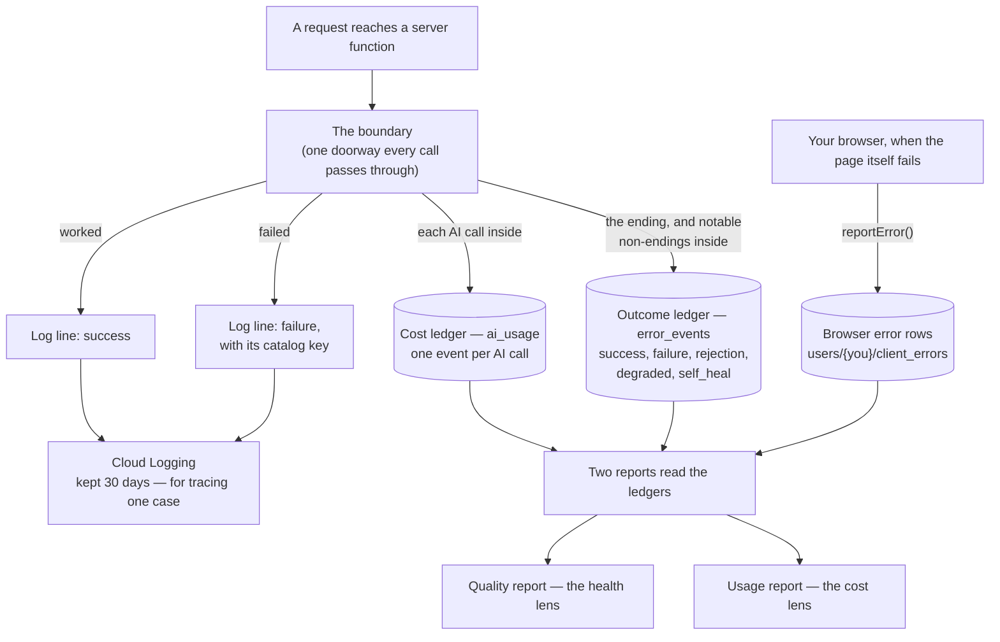
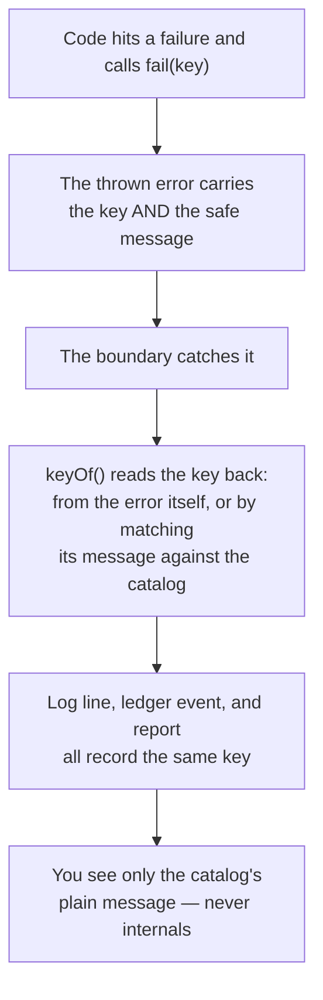
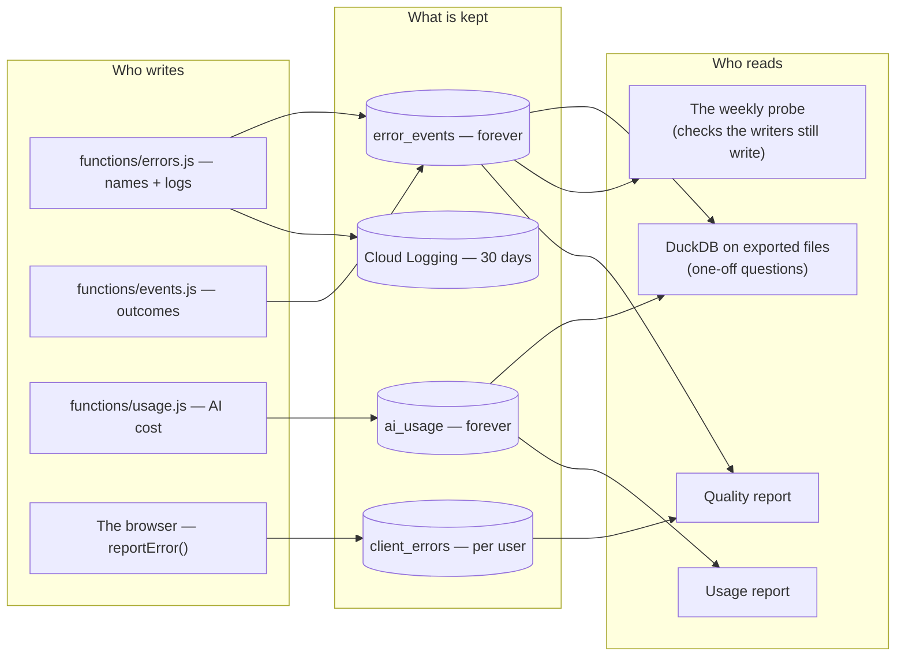

# Observability — How the App Watches Itself

This document explains how the Closet app records what happened inside
itself: what broke, what the AI cost, and what you were doing when
something failed. It is the living design document for that recording
system. When the recording system changes, this document changes in the
same commit — a document that lags the code is a defect here.

Built in three steps: OBS-1 (2026-10-19, structured logs and browser
error capture), OBS-3 (2026-10-23, the cost ledger), OBS-2 (2026-10-24,
the error-name repair, the outcome ledger, and the quality report). Cut
records live in `docs/SHIPPED.md` and the sprint folders.

## Words we use

| Word | What it means | Example |
|---|---|---|
| An event | One small record written at the moment something happens: what it was, when, and a few numbers. Events are counted and summed later. | "askStylist failed at 9:28, error name EMPTY_WARDROBE, took 1.2 seconds." |
| A log line | A line of text kept for reading one single case in detail. Logs are for tracing one story, not for counting. | The full record of one failed call, read while fixing it. |
| A ledger | A table of events kept forever, that reports are built from. We keep two: one for AI cost, one for outcomes. | The `ai_usage` ledger holds one event per AI call. |
| A catalog key | The official name of one kind of failure, from a fixed list (the catalog). Every failure must be recorded under its key. | `AI_BAD_RESPONSE` — the model answered in a shape the code could not use. |
| A category | The catalog's grouping for a key: whose fault the failure is. One of: auth, validation, dependency, internal. | `EMPTY_WARDROBE` is validation — the request itself could not be served. |
| A correlation id | One random id stamped on every event a single request causes, so its cost event, outcome event, and log lines can be read as one story. | One chat message produces three records, all carrying the same id. |
| An outcome kind | What sort of ending an event records. Five kinds exist; the table below defines each. | A `self_heal` event: the system caught its own bad answer and asked again. |
| Shape-only detail | A note about a failure that records structure, never content: which fields a bad answer had, never their values. | "detail: args had keys [items, note]" — the note's text is never stored. |
| A pricing version | The name of the price table used to turn raw usage (tokens, seconds) into a dollar estimate. The version is stored on every cost event. | `2026-10-23.v1`. If prices change, old events keep their version and can be re-priced. |
| Cost per successful outcome | The headline cost number: total AI spend divided by the number of calls that worked. | "One catalogued item costs about $0.04 of AI." |
| The probe | A test account that makes one call designed to fail in exactly one known way, once a week, to prove the recording system itself is still alive. | The probe asks the stylist with an empty wardrobe; the failure must appear in the ledger, with its key. |
| A spike flag | The quality report's warning mark: a function whose recent failures jumped compared with its own normal rate. | "describeItem failed 4 times in 24 hours, 3× its usual rate." |

## The pictures

### Where every kind of record goes

### How a failure keeps its name

Before OBS-2, step one did not attach the key. Failures arrived at the
ledger named "(uncoded)" — the name existed where the failure happened
and was lost on the way. The tests now prove the key survives.

### The three stores and their readers

## How it works

1. **Every server call passes one doorway.** The callable boundary in
   `functions/index.js` wraps each function. It starts the correlation
   id and records how the call ends.
2. **A call that works** writes a success log line and a `success`
   outcome event with its duration.
3. **A call that fails** throws through `fail(key)` or `codedError(key)`.
   The boundary resolves the key with `keyOf()`, writes the failure log
   line and the `failure` outcome event, and returns only the catalog's
   plain message to the app.
4. **Every AI call inside** writes one `ai_usage` event: the raw units
   (tokens or predict-seconds), the time it took, whether it worked, and
   a dollar estimate stamped with its pricing version.
5. **Notable non-failures write events too.** Feature code sends them
   through one funnel per module (the stylist's `emitEvent`, the
   boundary's `onEvent` hook): a result the system refused
   (`rejection`), a lesser result the user silently got (`degraded`), a
   retry that fixed the system's own bad answer (`self_heal`).
6. **Browser failures** go through `reportError()`, which writes one row
   per failure with the session id and the last 12 things you did in the
   app (which screen, which window opened), so a page failure can be
   matched by time to the server's events.
7. **Recording never breaks the call.** Every observability write is
   fire-and-forget: if a write fails, the failure degrades to a log line
   and the user's call continues.
8. **Reports read the ledgers, never the logs**, when the question is a
   count or a rate. Logs are read only to trace one case.
9. **Once a week, the probe checks the checker.** A test account makes
   the empty-wardrobe stylist call. The probe then reads the outcome
   ledger: the failure must be there, with the key `EMPTY_WARDROBE`.
   Silence means it passed. You hear only about a double failure.

## Rules in tables

### The catalog — the fixed list of failure names

One list (`CATALOG`, in `functions/errors.js`) is the whole vocabulary
of failure. Every entry has four parts: the **key** (`AI_BAD_RESPONSE`),
the **category** (auth, validation, dependency, or internal), the
**gRPC code** (the technical code the app receives), and the **plain
message** (the only text the app ever shows — catalog messages reach
you word for word; internal detail never does). Tests guard the list:
every entry must have all four parts, `fail()` must provably carry its
key, and every gRPC code in the catalog must have a matching plain line
in the app's own error wording (`friendlyError`).

### The standing rules

| Rule | Why | Example |
|---|---|---|
| Events for counting, logs for tracing. Never rebuild a count by scraping logs later. | Logs expire in 30 days and were not written to be summed. | "Failures per day this month" comes from `error_events`, not from log searches. |
| Metadata only. No prompts, no photo bytes, no user content in any event. | The ledgers are kept forever; they must be safe to keep forever. | A rejected answer is recorded as its field names, never its text. |
| One correlation id per request, on every record it causes. | Cost, outcome, and logs must join into one story. | One chat message: one cost event + one outcome event + log lines, one id. |
| A failure is recorded under its catalog key, always. A failure recorded without its name is a failed recording. | "(uncoded)" failures cannot be counted, trended, or fixed by kind. | The pre-OBS-2 bug this rule now names. |
| Nothing silent. A fallback, a refusal, a retry, or a lesser result is an event. | The failures that hurt most are the ones where nothing threw. | The stylist discards a bad outfit and answers in text only: a `rejection` and a `degraded` event, not silence. |
| Raw units are kept next to every estimate, with the pricing version named. | Prices change; history must not be rewritten by a price change. | Tokens stored as counted; dollars recomputed under any version. |
| Observability writes are fail-safe: fire-and-forget. | The watcher must never become the thing that breaks the app. | If the ledger write fails, the user's call still succeeds. |
| The ledgers are server-written only. Browsers cannot write them at all (denied in the database rules). | A browser cannot be trusted to report its own server's failures, and a guest has no identity to write with. | The boundary is the one place every outcome passes exactly once. |
| Browser error rows are owner-create-only: you can write your own, read none back from the app. | Enough to report, never a reading surface. | `reportError()` creates; only the reports read. |

### The five outcome kinds (`error_events`)

| Kind | Means | Example |
|---|---|---|
| `success` | The call worked. | A stylist answer returned, with its duration. |
| `failure` | The call failed with a catalog key. | `AI_BAD_RESPONSE` on a catalogue call. |
| `rejection` | The system refused a result it was handed. | Trip packing arguments that did not map to real pieces (`trip_tool_args_rejected`); a stylist outfit thrown away after checking (`outfit_discarded`). |
| `degraded` | The user got a lesser result and would never have known. | A best-effort profile read failed (`subcall_degraded`); a repair failed and the chat fell back to text only. |
| `self_heal` | The system caught its own problem and tried again. | The trip packing re-ask; the outfit slot repair. Counted, so "how often does the first try fail?" is a number. |

### The cost ledger — one event per AI call (`ai_usage`)

| Field | Meaning |
|---|---|
| `ts` | Server timestamp |
| `correlationId` | Joins to logs and outcome events |
| `feature` | The function or sub-call (`describeItem`, `askStylist`, `extractGarment.provider`, …) |
| `provider` | `vertex` or `replicate` |
| `model` | The model id, as called |
| `uid` | Who called |
| `surface` | `upload`, `chat`, `trip`, `shop`, or `background` |
| `tokensIn` / `tokensOut` / `tokensThinking` | Provider-reported token counts, when available |
| `predictSeconds` | Replicate run time, when it applies |
| `latencyMs` | Wall-clock time of the AI call itself |
| `outcome` | `success`, `error:<key>`, or `gate_rejected` |
| `costUsd` | The estimate, priced under `pricingVersion` |
| `pricingVersion` | Which price table priced this event (`functions/pricing.js`) |
| `refId` | Item, photo, or trip id, where one exists |

Prices: Vertex charges per million tokens, per model (thinking tokens
bill as output). Replicate charges per second, by hardware class. A
price change ships as a new `pricingVersion`; any past window can be
re-priced from the stored raw units.

### The outcome ledger — one event per ending (`error_events`)

| Field | Meaning |
|---|---|
| `ts` | Server timestamp |
| `kind` | One of the five outcome kinds above |
| `fn` | The function, or `function:event` for a sub-event (`askStylist:outfit_discarded`) |
| `key` | The catalog key, when the event is a failure |
| `category` | The key's category |
| `correlationId` | Joins to logs and cost events |
| `uid` | Who called |
| `durationMs` | Successes only |
| `detail` | Shape-only context (argument names, stage names), at most 300 characters |

### The browser's rows (`users/{uid}/client_errors`)

Written by `reportError()`: `where` (which part of the page), `code`,
`message` (capped), `page`, `userAgent`, `createdAt` — plus `sessionId`
(one per page load) and `trail` (your last 12 stamped actions, fed by
hooks in the screen-switch and window-open code). Writes are capped per
session and loop-guarded, so a failing page cannot flood its own ledger.

### The reports

| Report | Answers | Notes |
|---|---|---|
| `scripts/quality-report.js [--days N]` | Per function: counts and rates of success and failure, top error keys, success time (middle and 95th percentile), the non-failure kind counts, AI outcomes, browser-error summary. | Spike flag rule: a function's last-24-hours failure rate is flagged when it has at least 3 failures AND runs at least 2× its window baseline. Notify-only by decision — the report is the alerting surface until a digest is built (OP-1). |
| `usage-report.js` | Spend by feature × provider × model, the trend, success beside cost, cost per successful outcome, and unit costs (per item catalogued, per stylist turn). | The cost lens to the quality report's health lens. |
| The probe (`scripts/heartbeat-probe.js`, weekly) | Is the recording system itself alive? | The probe account's events are excluded from report statistics (they are synthetic) and shown as a liveness line instead. Its credentials live in `.heartbeat-probe.json` (gitignored, private) — a data-less test account, not a user credential. |
| One-off questions | Anything else. | Export a window, query locally with DuckDB over files — no extra infrastructure. |

### Choices made, and what was rejected

| Choice | Why | Rejected alternative |
|---|---|---|
| Ledgers in the database, not log queries only | Logs expire in 30 days and sum badly; the standing questions are "since when?" questions. Append-only events are queryable forever at this size, for about no cost. | The OBS-1 logging-only design — it is why failures stayed invisible until a user reported them. |
| No Sentry (yet) | The studio standard names Sentry's free tier as the default crash surface, but Closet's failures are domain-shaped (refusals, gates, self-heals) that a crash tool does not model. The ledger and report cover the need with no new vendor. | Revisit when a second product needs crash aggregation across stacks (OP-5). |
| Server-side writes only | See the standing rules. | Letting the browser report server outcomes. |
| Shape-only detail | Enough to classify a failure, never user content. | Storing full payloads "for debugging" — unsafe to keep forever. |
| One funnel per module for sub-events | "Did we record X?" has exactly two places to check, and the tests can guard both. | Recording calls scattered through feature code. |
| Growth path: database → BigQuery, same event shapes | Only when a report actually hurts. No warehouse, no streaming pipeline before then. | Building the pipeline now. GCP billing alerts stay the backstop for *total* cloud spend — the ledgers answer what billing cannot: which feature, on what, and whether it worked. |

## Known limits today

- **The quality report is on-demand.** Nothing runs it on a schedule and
  nothing pushes a spike warning. By decision, that waits until the
  report's shape has proved itself (OP-1); the probe covers only the
  "is it alive" half.
- **The ledgers grow forever.** At today's size (a few KB a day) that is
  fine and deliberate. It stops being fine at a volume we have not set a
  number for (OP-2).
- **Browser errors are raw rows.** The report groups them by place and
  session; it does not yet merge repeats of the same error into one
  counted item (OP-3).
- **The spike rule is a first guess.** At least 3 failures and at least
  2× baseline has not yet been tested against a month of real flags
  (OP-4).
- **The brief itself is not recorded.** For the stylist, we record that a
  call happened and what it cost — not the facts the model was shown. So
  "why did it answer that?" still cannot be answered from the records.
  That gap belongs to the stylist overhaul (its working documents live
  in `docs/sprints/sprint-23/`).

## Decisions still open

Propose improvements against these numbers.

- **OP-1 — Scheduled digest.** A weekly digest (and a pushed spike
  warning) is the named follow-up, deliberately not built until the
  on-demand report proves its shape. *Partly answered 2026-10-24:* the
  probe covers the "is it alive at all" half, on the same weekly
  cadence; the digest half still waits for a second user or real
  report-reading pain.
- **OP-2 — Retention.** The ledgers are append-only forever at current
  volume. If volume grows: time-to-live expiry, or rollup-and-prune —
  decided from real numbers.
- **OP-3 — Browser-error grouping.** Grouping by place + session happens
  in the report; fingerprint dedupe (merging repeats of the same error)
  does not.
- **OP-4 — Alert thresholds.** The spike rule (≥3 failures, ≥2×
  baseline) is a heuristic. Tune it from the first month of real flags —
  or record why it is right.
- **OP-5 — Cross-product shape.** This design is the Closet's. A second
  product adopting it is the trigger to lift the shared parts into the
  studio's logging-and-observability standard.

## Code pointers

As of 2026-10-24.

- Names and logging: `functions/errors.js` — the catalog (`CATALOG`),
  `fail`, `codedError`, `keyOf`, `logError`, `logEvent`.
- The doorway and its wiring: `functions/index.js` — `boundary`,
  `finish`, `recordErrorEvent`, the `onEvent` wrap at the askStylist
  call.
- The ledger writers: `functions/events.js`, `functions/usage.js`,
  `functions/pricing.js`.
- The stylist's sub-event funnel: `emitEvent` in `functions/stylist.js`.
- The browser side: `reportError`, `closetSessionId`, `noteTrail` in
  `public/index.html`.
- Reports: `scripts/quality-report.js`, `usage-report.js` (repo root of
  the hosting folder), `scripts/heartbeat-probe.js`.
- Tests guarding the name-keeping rule: `tests/errors-server.test.js`,
  `tests/errors-client.test.js`, `tests/usage-retrofit.test.js`.
