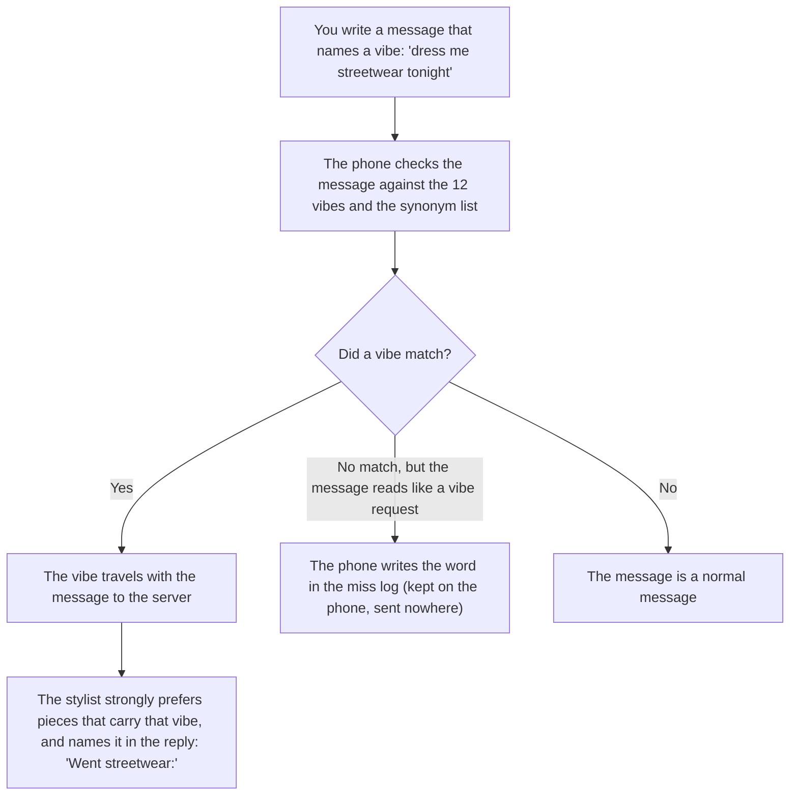
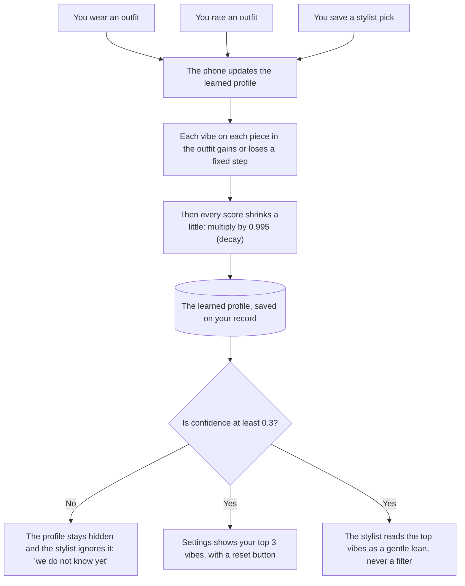

# Personalization — how the app learns your taste

Written in the studio design-document format
(standards/design-documents.md). First version 2026-10-18;
rewritten into this format 2026-10-24. Function names are
the pointers that matter; line numbers drift.

## What this is

The app learns what you like to wear, in two ways. You
can name a style in a chat message and the stylist obeys
it for that answer. And the app quietly keeps score of
the styles on the clothes you wear, save, and rate
highly, and leans future picks toward the high scores.
This document is the design of both halves: what counts
as evidence, how the score moves, and when the score is
allowed to influence an answer.

## Words we use

| Name | What it means | Example |
|---|---|---|
| A vibe | One of 12 fixed style words the app knows (the tag set from PC-30) | "streetwear", "minimalist" |
| A tag | A vibe attached to one piece of clothing | The blazer carries the tag "minimalist" |
| The vibe handle | Naming a vibe in a chat message so the stylist follows it for that answer | "Dress me streetwear tonight" |
| The learned profile | The saved scores: one score per vibe, plus how much evidence backs each score. Stored as `vibeProfile` on your user record | minimalist 0.82 from 34 pieces of evidence |
| A signal | Something you do that counts as evidence for or against the vibes on the pieces involved | Wearing an outfit; rating it 9 out of 10 |
| The score | A number from 0 to 1 per vibe. Higher means the app believes you like that vibe more | streetwear 0.61 |
| Confidence | One number from 0 to 1: how much total evidence the profile holds. 40 pieces of evidence make confidence 1 | Confidence 0.5 means about 20 pieces of evidence |
| Decay | A slow shrink of every score each time the profile updates, so old taste fades instead of freezing | Every score is multiplied by 0.995 per update |
| Style notes | A different thing with a similar name: preference sentences you confirmed, kept as `styleProfile`. Not scores | "Never suggest skinny fits" |

Warning that has already bitten once: the learned
profile is `vibeProfile`. The name `styleProfile` is
taken by the style notes. The two never mix.

## The pictures

### Picture 1 — the vibe handle: you name it, the stylist obeys it



### Picture 2 — the learned profile: how a score is born, lives, and fades



## How it works, step by step

**The vibe handle**

1. You name a vibe in a chat message. The phone checks
   the message for the 12 vibe words and their synonyms.
2. A match travels with the message. The stylist then
   strongly prefers pieces that carry that vibe and
   names the vibe in its reply, so you can see the
   handle worked.
3. No match: if the message still reads like a vibe
   request, the phone counts the unknown word in a miss
   log. The log stays on the phone. We review it from
   time to time and either add the word as a synonym or
   reject it on purpose.

**The learned profile**

4. A signal happens: you wear an outfit, rate an
   outfit, or save a stylist pick.
5. The phone adds a fixed step to the score of every
   vibe on every piece in that outfit — up for good
   signals, down for a low rating. Learning works per
   vibe, not per piece, on purpose: one 5-star outfit
   holds about four pieces, and nobody can say which
   piece earned the stars. Vibes repeat across pieces,
   so evidence about a vibe adds up cleanly (see
   "What is wrong today" for the cost of this choice).
6. Every score then shrinks by decay (× 0.995), and the
   evidence count for each touched vibe grows by one.
   Evidence counts never shrink.
7. Before each stylist answer, the server reads the
   profile. At confidence 0.3 or more, the top vibes go
   into the brief as one line, as a gentle lean.
8. You can see the result in Settings → "Your vibe"
   (top 3 vibes, only at confidence 0.3 or more) and
   clear the whole profile with the reset button.

## Rules in tables

### What each signal does to a score

| Signal | Change to each vibe on each piece involved | Where it happens |
|---|---|---|
| You wear the outfit | +0.04 (weak on purpose: wearing is not the same as loving) | The worn button, in `public/index.html`; the wear is saved to `wear_events` |
| You rate the outfit 8–10 of 10 | +0.06 | `saveRating()` in `public/index.html`; ratings saved to `ratings` |
| You rate the outfit 0–3 of 10 | −0.06 | Same |
| You rate the outfit 4–7 of 10 | No change (a middle rating is not a signal) | Same |
| You save a stylist pick | +0.03 | `saveChatOutfit()` in `public/index.html` |
| A shop check ends in bought or dismissed | No change (too noisy; a bought piece earns its score later, by being worn) | — |

### Who wins

| The disagreement | The winner | Example |
|---|---|---|
| You name a vibe; the learned profile leans another way | The vibe you named | You write "streetwear"; your minimalist lean is ignored for that answer |
| The learned profile leans one way; nothing is named | The lean applies, gently | More minimalist pieces appear in picks, but a strong non-minimalist outfit still wins over a weak minimalist one |
| Confidence below 0.3; a lean exists on paper | Nobody: the profile is ignored and hidden | A new user gets picks with no lean at all |

### The fixed numbers

| Number | Value | Why |
|---|---|---|
| Score range | 0 to 1, clamped | Keeps scores comparable |
| Decay per update | × 0.995 | Taste drift wins over time |
| Confidence formula | total evidence ÷ 40, capped at 1 | 40 signals is "we know your taste" |
| Confidence gate | 0.3 (about 12 signals) | Below it, the honest answer is "we do not know yet" (founder decision, 2026-10-18) |
| Synonyms per vibe | At most 4, each synonym maps to exactly one vibe | Stops the synonym list from growing into a second vocabulary (founder policy, 2026-10-18) |
| Step sizes in the signal table | First-pass values | The founder had "no good intuition yet" (2026-10-18); revisit when real data exists |

### What the saved profile looks like

```json
{ "tags":     { "minimalist": 0.82, "streetwear": 0.61 },
  "evidence": { "minimalist": 34,   "streetwear": 21 },
  "updatedAt": "<timestamp>" }
```

Stored at `users/{uid}/vibeProfile`. The field is
additive — no data migration; a new user simply has no
scores yet.

## What this design refuses to do

- **No guessing vibes from photos or names.** Evidence
  is behavior only: wears, ratings, saves.
- **No hard filter.** A vibe leans a pick; it never
  removes pieces from reach. A vibe you name always
  beats the lean.
- **No learning across users.** The profile is per
  person and never pooled.
- **No permanent labels.** Decay means a vibe you stop
  wearing stops ruling your picks.

## What is wrong today / still open

1. **The loop can trap itself (open problem, founder
   2026-10-18).** The profile learns only from what you
   wear. A vibe you never try keeps a score near 0, so
   the stylist never suggests it, so you never try it.
   Candidate answers, none chosen: occasional trial
   suggestions ("you have never tried edgy — want to?"),
   or a "surprise me" handle that explores on purpose.
   Parked in BACKLOG.md as a future modeling question;
   not for this version.
2. **Two writers can overwrite each other.** The phone
   updates the profile on each signal; two quick signals
   on two devices could race, and the last write wins.
   Accepted for now (one user, few signals); noted so
   the first multi-device bug is not a surprise.
3. **The step sizes are guesses.** They stand until real
   wear and rating data says otherwise. The revisit
   trigger is data, not taste: once the profile has a
   few hundred signals, check whether the top vibes in
   Settings match what the founder would say about his
   own taste.

## Code pointers

- Naming a vibe in a message: `detectVibeTag` near the
  chat send path in `public/index.html`; the synonym map
  and the miss log live beside it.
- The stylist reads the profile: `buildStylistRequest`
  in `functions/stylist.js` (the "wearer vibe profile"
  line), fed by the server-side read in the `askStylist`
  handler in `functions/index.js`; the profile is
  cleaned by `sanitizeVibeProfile`.
- Signals: the worn button handler, `saveRating()`, and
  `saveChatOutfit()` in `public/index.html`.
- The display and the reset: Settings → "Your vibe" in
  `public/index.html`.
- Style notes (the other system): `sanitizeStyleProfile`
  in `functions/stylist.js`.
