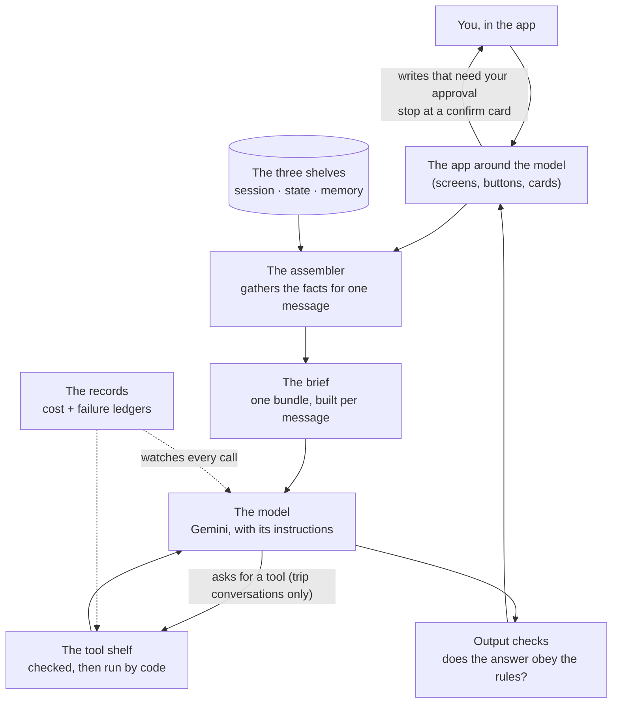
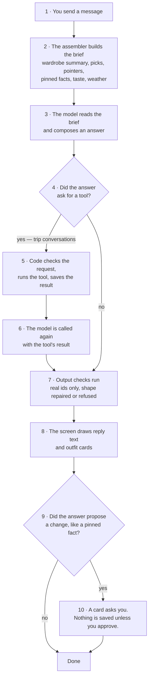
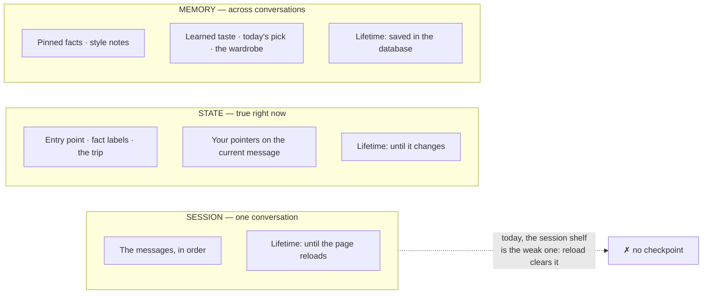

# The Stylist, Described as an Agent

The architecture of the Closet stylist, written in the same words the
industry uses for agents, so our design can be compared with theirs. This
document describes the shape of the system. What is wrong with the shape
today, and the decisions that would change it, live in
[CURRENT-STATE.md](CURRENT-STATE.md). The code evidence lives in
[AUDIT.md](AUDIT.md).

The short version: the stylist is **one agent, not several**. It is a single
AI model, given instructions, a small shelf of tools, and a bundle of facts
assembled fresh for every message. The app — not the model — controls the
steps around each model call. In the industry's words, that puts the
stylist between a *workflow* and a free *agent*: the model composes its
answer freely, but it walks a path the code fixed in advance.

Kept current as the architecture evolves. Last updated 2026-10-24, code
pointers as of commit `2c37032`.

## Words we use

The industry words, defined the way we use them. The product words (today's
pick, pointer, pinned fact, fact label) are defined in CURRENT-STATE.md and
used here with the same meanings.

| Word | What it means here | Example |
|---|---|---|
| Agent | A program where an AI model does a job using context and tools, inside limits the code sets. | The stylist: it reads your wardrobe facts and composes an outfit answer. |
| Workflow | Fixed code steps with model calls placed inside them. The code decides the order; the model fills in the blanks. | Our catalogue photo analysis: photo in, fixed steps, item card out. |
| The augmented model | Anthropic's name for the basic building block: a model plus three attachments — facts it can look up, tools it can call, and memory it can read. Every agent pattern is built from this block. | The stylist is one augmented model: Gemini, plus wardrobe facts, plus trip tools, plus your pinned facts and taste records. |
| Instructions | The standing orders given to the model on every call: its job, the house rules, and the exact shape its answer must take. | "You are the stylist. Answer with this JSON shape. Never invent a piece id." |
| Context assembly | Choosing, for one call, exactly which facts the model gets to see, and in what order. Anthropic calls the whole craft *context engineering*: the model's attention is a limited budget, so every fact in the bundle has to earn its place. | Step 2 of a turn: the brief is gathered from nine places and ordered before the model is called. |
| The brief | Our name for the assembled bundle for one call: instructions, facts, pointers, conversation, message. | One brief is built per message you send. |
| A tool | A named action the model may ask the code to run, with checked inputs. OpenAI sorts tools into *data tools* (look something up) and *action tools* (change something). | `get_weather` is a data tool. `save_outfit` is an action tool. |
| A session | One conversation, in Google ADK's sense: the ordered history of its messages, kept together as one thing. | Your general conversation; each trip conversation is its own session. |
| State | The scratchpad attached to a session: the facts true *right now* in this conversation. ADK keeps state separate from the session's history on purpose. | Which entry point opened the chat, the fact labels showing, the trip in play, your pointers. |
| Memory | Facts kept *across* sessions, read back into later briefs. ADK keeps memory as its own store, separate from any one session. | Pinned facts, style notes, learned taste — all saved in the database. |
| Compaction | When a conversation grows long, summarizing the old part on purpose and continuing from the summary. Anthropic's recommended way to handle long conversations. | We do not do this. We silently keep only the last 20 messages — see CURRENT-STATE.md, problem P7. |
| Structured notes | Anthropic's second long-conversation technique: the agent writes small notes outside the conversation and reads them back later, instead of relying on the history. | Our pinned facts are exactly this — with you as co-author: the stylist proposes, you approve the note. |
| A checkpoint | Saving a session so it survives a restart and can be resumed. Frameworks treat this as a named part: ADK's *session service*, LangGraph's *checkpointer*. | We have none. A page reload ends every session — problem P6. |
| Checks (guardrails) | Code that inspects what goes into and out of the model, in layers. OpenAI's guide lists them as a standard part of every agent. | Dropping piece ids the model invented; asking you to approve a pinned fact before it is saved. |
| Read-back | A record of what the model actually saw and did on a turn, so behavior can be explained afterwards. Products call this *tracing*. | We record that a call happened and what it cost (OBSERVABILITY.md). We do not record the brief itself — problem P10 in CURRENT-STATE.md is the display side of this gap. |

## The pictures

### The parts, and how they connect

### One turn, step by step

### The three shelves where facts live

## How one turn works

The same turn CURRENT-STATE.md walks through, named in architecture words.

1. **You send a message.** The app holds the session (the conversation) and
   the state (labels, trip, pointers) in the page.
2. **Context assembly.** One function gathers the brief: instructions, the
   wardrobe as one-line summaries with ids, today's pick and the previous
   pick when attached, your pointers, the trip when there is one, the last
   20 messages, and your words.
3. **The model call.** The brief goes to Gemini on the server. Server code
   adds the memory shelf itself — pinned facts, style notes, learned
   taste. The weather, measured on your phone, arrives with the brief.
4. **Tool use, when asked.** In a trip conversation the model may answer by
   asking for a tool. Code checks the request, runs the tool, and calls the
   model again with the result. In the general conversation there are no
   callable tools; the model returns its actions inside its answer text,
   and code carries them out. Two mechanisms for one job — see the gaps
   table below.
5. **Output checks.** The answer is inspected before anything is drawn:
   invented ids are dropped, broken shapes are repaired once, and some
   failures earn one silent retry with a stricter instruction.
6. **Rendering.** Reply text and outfit cards are drawn from the checked
   answer.
7. **Writes wait for you.** Anything the answer proposes saving — a pinned
   fact, a style note — stops at a card and is written only on your tap.
   Tool writes in a trip (saving an outfit to the trip) happen on the
   model's word, after the argument checks.

## The parts, in tables

### Components

| Part | Industry name | Our code | Its one job |
|---|---|---|---|
| The screens and cards | The host application | `public/index.html` | Everything the model is not: display, buttons, approvals. |
| `buildStylistRequest` | Context assembler | `functions/stylist.js` | Build the brief: choose the facts, order them, state which fact wins. |
| Gemini (`gemini-3.5-flash`) | The model | Called from `functions/index.js` | Read one brief, compose one answer. |
| Trip tools | Tools (data + action) | Declared in `functions/index.js`, run by server helpers | Let the model look up weather, save trip outfits, propose pinned facts. |
| The checks | Guardrails / output validation | Sanitizers and validators in `functions/stylist.js` and `functions/index.js` | Keep invented or malformed answers from reaching the screen or the database. |
| The session | Session (ADK sense) | `chatThreads`, in page memory | Hold one conversation's messages. Not saved anywhere — no checkpoint. |
| The memory shelf | Memory service (ADK sense) | Database collections: `context_pins`, `today_picks`, the user record | Hold facts across conversations and feed them into briefs. |
| The records | Tracing / observability | `ai_usage` and `error_events` ledgers | Record each call's cost and failures. The brief itself is not recorded. |

### The tool shelf today

| Tool | Kind | What it does | Checks before it runs |
|---|---|---|---|
| `get_weather` | Data tool | Returns the forecast for the trip's place and dates. | Dates and place come from the trip record, not the model. |
| `save_outfit` | Action tool | Saves an outfit to the trip. | Every piece id must exist in your wardrobe; broken requests are refused with a reason the model can read. |
| `pin_context` | Action tool (proposes) | Proposes a pinned fact from inside a trip conversation. | Same approval rule as everywhere: saved only when you approve it. |

In the general conversation the model has no tool shelf. Its answer
carries fields instead — an outfit, a proposed pinned fact, a style-note
change — and the host acts on them. Industry systems pick one mechanism;
we run both, which is why behavior differs between the two conversations in
ways nobody designed (CURRENT-STATE.md, problems P4 and P5).

### Memory: what is kept, where, and who may write it

| Shelf | Holds | Stored where | Lifetime | Who writes |
|---|---|---|---|---|
| Session | The messages of one conversation | Page memory only | Until reload | You and the stylist, by talking |
| State | Entry point, fact labels, the current trip, pointers | Page memory | Until it changes | The app, from your taps |
| Memory | Pinned facts (max 20) | Database, `context_pins` | Until you delete one | The stylist proposes; you approve |
| Memory | Style notes (confirmed preferences) | Database, user record | Until changed | You confirm each change |
| Memory | Learned taste (scores per style word) | Database, user record | Always updating | The app, silently, from wears and ratings — full rules in PERSONALIZATION.md |
| Memory | Today's pick | Database, `today_picks` | One day | The app, each morning |

## How the industry frames map onto us

| Frame (source) | Their idea, in one line | Where we stand |
|---|---|---|
| The augmented model (Anthropic, *Building Effective Agents*) | Every agent is a model plus facts, tools, and memory. Start from this block. | **Match.** The stylist is exactly one augmented model. |
| Workflow vs agent (Anthropic, same) | Workflows follow code paths fixed in advance; agents direct their own steps. Use the simplest shape that works. | **Hybrid, by design.** Fixed path around the call; free composition inside it; a small tool loop in trip conversations only. |
| One agent first (OpenAI, *A Practical Guide to Building Agents*) | Grow a single agent's ability before splitting into several; splitting adds cost and confusion. | **Match.** One stylist. No multi-agent plans — see the NOT-importing list in AGENT-FUNDAMENTALS.md. |
| Instructions + tools + model (OpenAI, same) | An agent is those three parts; most of the craft is in the instructions and the tool shelf. | **Match, with a wart.** Our craft sits in the assembler and instructions — and in a second, unplanned mechanism (answer fields acting as tools) in the general conversation. |
| Guardrails in layers (OpenAI, same) | Checks belong at entry, around tools, and on output — not in one place. | **Partial.** Output checks are strong. Entry checks are size limits. Around tools, argument checks exist in trip mode only. For a private, single-user wardrobe app the missing public-safety layers are a deliberate non-goal. |
| Context engineering (Anthropic, *Effective Context Engineering for AI Agents*) | The brief is a budget: assemble deliberately, keep it small, order it well. | **Match in habit.** The brief is rebuilt per message and ordered by a fixed plan — but the plan is written as prose inside the instructions (problem P8). |
| Compaction (Anthropic, same) | Long conversations get summarized on purpose. | **Missing.** Old messages are cut silently at 20 (problem P7). |
| Structured note-taking (Anthropic, same) | Durable facts live outside the conversation, written as notes and read back in. | **Match — our best idea.** Pinned facts and style notes are notes with a human approver. This is the pattern to extend, not replace. |
| Session, state, memory as separate things (Google, ADK) | A conversation, its scratchpad, and long-term memory are three different stores with three different lifetimes. | **Concepts match; one store is weak.** Our session shelf is ADK's *in-memory* session option — the one ADK's own guides call a development choice, because a restart wipes it (problem P6). |
| Just-in-time facts (Anthropic, context engineering) | Give the model light pointers (ids, summaries); let it fetch detail when needed, instead of loading everything up front. | **Halfway.** The wardrobe travels as ids plus one-line summaries — the light-pointer half. The model cannot fetch more detail when it needs it; your @-pointers are the manual version of fetching. |

## The gaps, stated as architecture

Each gap names the standard part that is missing or doubled. The plain
problem and the decision that settles it live in CURRENT-STATE.md.

| # | Missing or doubled part | What it costs us | Decision |
|---|---|---|---|
| A1 | **One assembler.** Brief-building lives in two places: the app attaches some facts, the server adds others. | Four entry points attach four different subsets; nobody can say what the model saw. | Q1, Q2 |
| A2 | **One tool mechanism.** Trip conversations use real tools; the general conversation uses answer fields that act like tools. | Different checks, different failure shapes, behavior that differs by conversation for no designed reason. | Q4 |
| A3 | **A checkpoint for sessions.** No part saves a conversation. | Reload ends every conversation, including mid-trip planning. | Q7 (CURRENT-STATE.md decision list) |
| A4 | **A history policy.** No compaction; a silent 20-message cut instead. | The stylist forgets early messages mid-conversation and nobody is told. | Q7 |
| A5 | **Precedence as a table.** "Which fact wins" is prose inside the instructions. | Two facts can conflict with no settled winner; the model improvises (P8). | Q6 |
| A6 | **Read-back of the brief.** Records keep cost and failures, not what the model saw. | "Why did it say that?" cannot be answered after the fact (P10). | Q9 |

## Decisions still open

All of them are listed, in plain words with the feel of each choice, in
CURRENT-STATE.md — this document does not repeat them. One framing
question belongs here, because it is about the shape itself:

**Do we deepen the fixed path, or grow the loop?** The fixed path
(workflow-style) means every reply costs one model call, two in a trip, and
its behavior can be tested end to end. Growing the loop (agent-style)
means the stylist could decide mid-answer to check the weather, look at a
trip, or fetch a piece's full record before replying — more capable, and
each added loop adds cost, waiting time, and a new way to surprise you.
The industry guidance (Anthropic and OpenAI agree here) and our own audit
point the same way: deepen the fixed path first — one assembler, one tool
mechanism, saved sessions — and let the loop grow only where a named
problem needs it.

## Sources for the industry frames

- Anthropic, *Building Effective Agents* (engineering guide, 2024) — the
  augmented model; workflows vs agents; the standard patterns.
- Anthropic, *Effective Context Engineering for AI Agents* (engineering
  guide, 2025) — context as a budget; compaction; structured note-taking;
  just-in-time facts.
- OpenAI, *A Practical Guide to Building Agents* (2025) — model, tools,
  instructions; one agent first; guardrails in layers.
- Google, *Agent Development Kit (ADK) documentation* — session, state,
  and memory as separate stores; session storage options and their
  lifetimes.
- Google, *Agents* (whitepaper, 2024) — the model / tools / orchestration
  split this document's component table follows.

## Code pointers

As of commit `2c37032`, shared with CURRENT-STATE.md. Server:
`functions/index.js` holds the callable handler and the trip tool
declarations; `functions/stylist.js` holds `buildStylistRequest` (the
assembler and instructions). Client: `public/index.html` holds the session
and state shelves (`chatThreads`, entry points, fact labels). The audit's
evidence for every claim here is in AUDIT.md.
