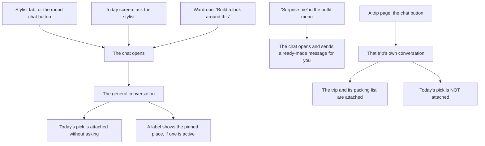
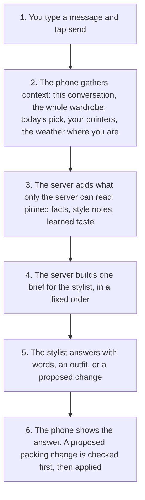
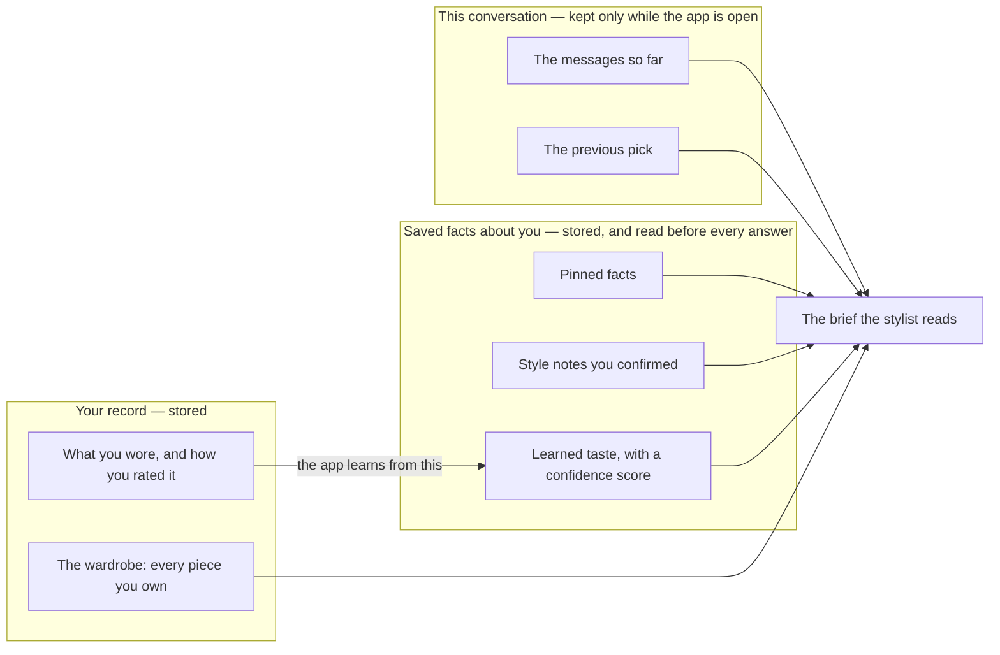

# The stylist chat — how it works today

Written 2026-10-24, in the studio design-document format
(standards/design-documents.md). This document describes
the stylist as it works NOW. The decisions that will
change it are at the end, still open. The evidence behind
every claim is in AUDIT.md, in this folder.

## What this is

The stylist is the AI that picks outfits from your
wardrobe when you chat with it. Before it answers, the
app tells it many things besides your message: your
whole wardrobe, today's outfit, facts you saved, and
more. Those extra things are called the **context**, and
today the context is put together by several pieces of
code that grew at different times. Nobody designed the
whole thing once, so the pieces disagree in places.
This document is the one place that shows the whole
thing as it is.

## Words we use

One name per thing, used the same way through the whole
document.

| Name | What it means | Example |
|---|---|---|
| The stylist | The AI that answers in the chat and picks outfits | It answers "what goes with this blazer?" |
| A conversation | The list of messages between you and the stylist on one topic | The general chat is one conversation; each trip has its own |
| An entry point | A button or screen that opens the chat | The Stylist tab; the chat button on a trip page |
| Context | Everything the stylist is told before it answers, besides your message | Your wardrobe, today's outfit, a pinned fact |
| Today's pick | The outfit on your Today screen this morning | The outfit the Today screen chose at 8am |
| The previous pick | The last outfit the stylist suggested inside this conversation | You say "swap the shoes" and it changes that outfit |
| A pointer | A piece or a saved outfit that you attach to one message by typing @ and choosing it | You point at the blue blazer and ask "what goes with this?" |
| A pinned fact | A fact you confirmed that the app should remember for a while | "I am in Tahoe until Sunday" |
| A fact label | A small pill at the top of the chat screen. One pill means one piece of context is active | The pill that reads "◈ Today's pick" |
| The top outfit card | The large box at the top of the conversation that shows one outfit with its photos | The card that shows today's outfit when the chat opens |
| Style notes | Preferences you confirmed about how you like to dress | "Never suggest skinny fits" |
| Learned taste | Patterns the app learned from what you wore and how you rated it, held with a confidence score | It favors earth tones for you, confidence 0.6 |
| A style word | One word from a fixed set that you can name in a message to steer the pick | "Dress me streetwear tonight" |
| A proposed change | A change the stylist suggests. Nothing changes until the change is checked and confirmed or applied by the app | "Move the red sweater into the Tahoe packing" |

## The pictures

### Picture 1 — the entry points, and what each one attaches

### Picture 2 — the life of one message

### Picture 3 — the three kinds of memory

## How it works, step by step

1. You open the chat from an entry point. The app picks
   the conversation for that entry point: the general
   conversation, or the trip's conversation.
2. If the conversation is empty, the app writes the
   first message itself: a greeting, or for a trip, a
   line that names the trip.
3. For a general conversation, the app attaches today's
   pick. A fact label appears at the top of the screen.
4. You type a message and tap send. You can attach a
   pointer to the message by typing @.
5. The phone gathers the context (Picture 2, step 2) and
   sends it to the server.
6. The server checks every piece of context, adds the
   saved facts only it can read, and builds the brief
   in a fixed order: the basic instructions, your style
   notes, the weather, today's pick, the previous pick,
   your pointers, a style word if you named one, your
   learned taste, the pinned facts, then the messages.
7. In a trip conversation the server also gives the
   stylist three tools: change the packing, propose a
   pinned fact, and suggest outfits from the packing.
8. The stylist answers. The phone shows the answer. An
   outfit appears as a card you can save. A proposed
   packing change is checked by the phone (every piece
   must be real and packed) and then applied.
9. In a general conversation, the stylist can also
   propose a pinned fact. The proposal appears as a card
   with Save and Dismiss. Nothing is saved unless you
   tap Save.

## Rules in tables

### Who wins when two things disagree

| The disagreement | The winner | Example |
|---|---|---|
| You name a style word; your learned taste points the other way | The style word you named | You write "streetwear"; the pick follows streetwear, not your usual taste |
| You attach a pointer; the previous pick exists | The pointer | You point at the blazer; the new outfit is built around the blazer |
| You state weather in the chat; a pinned fact carries weather | The weather you stated | The pinned fact says Tahoe snow; you write "plans changed, I am home" — home weather rules |
| A pinned fact carries weather; the phone measured the weather where you are | The pinned fact | You are pinned to Tahoe; the phone sits in California; Tahoe weather rules |
| The conversation has no pick of its own yet; today's pick is attached | Today's pick becomes the pick that changes build on | You open the chat and write "warmer" — today's outfit is the one that changes |
| A rule in your style notes; anything else | The style note | "Never suggest skinny fits" removes skinny fits from every pick |

### Limits that exist today

| Limit | Value | Who set it |
|---|---|---|
| Messages from the conversation that the stylist reads | The last 20 only | The server, silently |
| Length of one message the stylist reads | 2,000 characters | The server |
| Pinned facts read before an answer | Up to 20 | The server |
| Wardrobe sent before an answer | Every piece, every time | The phone |
| Conversations kept after the app is closed or reloaded | None — all are lost | Nobody chose this; it is how the code grew |

### What each entry point attaches, without asking you

| Entry point | Conversation | Attached without asking | You can see it | You can remove it |
|---|---|---|---|---|
| Stylist tab / chat button | General | Today's pick; pinned facts; measured weather | Today's pick: a fact label and the top outfit card. Pinned facts: only a pinned place shows a label | Today's pick: tap the × on its label. It returns the next time you open the chat |
| Today screen: ask | General | The same as above | The same as above | The same as above |
| Build a look around this | General | The same, plus a pointer to that piece, plus typed text you still must send | The pointer shows as a label above the typing box | Remove the pointer's label before sending |
| Surprise me | General | The same, plus a message the app writes and sends for you | The sent message, after it is sent | No |
| A trip page | That trip's | The trip, its packing list, its stored weather. Today's pick and place pins are left out on purpose | A trip label at the top of the screen | Leave the trip conversation |

## What is wrong today

Each problem names the audit item it came from, so the
evidence is one click away in AUDIT.md.

1. **Today's pick joins every general conversation
   without being asked** (D1). You opened the chat to
   ask about something else; the stylist assumes you
   mean today's outfit. The founder flagged this on
   2026-10-24: "not expected."
2. **Two displays show today's pick, and they can
   disagree** (D2). The fact label reads a copy made
   when the chat opened. The top outfit card reads the
   live Today screen. Remove the label and the outfit
   leaves the context, but the card still shows it.
3. **The rule for "which outfit are we changing" is
   written twice** (D3) — once on the phone, once on
   the server. Two copies of one rule will drift apart.
4. **Most pinned facts are invisible** (D4). Only a
   pinned place shows a label. A pinned weather fact and
   pinned preferences shape every answer and show
   nowhere — not even in the morning pick, where they
   also apply.
5. **One idea, two mechanisms** (D5). A proposed pinned
   fact travels as a field inside the reply in a general
   conversation, and as a tool call in a trip
   conversation.
6. **The morning pick uses the same stylist with less
   context sent — and the saved facts still apply**
   (D6). The Today screen and the outfit composer send
   no today's pick and no pointers, yet pinned facts,
   style notes, and learned taste are added by the
   server all the same. You cannot see them apply
   anywhere.
7. **Conversations die with the app** (D7). Close or
   reload the app and every conversation is gone,
   general and trips alike. Within one session a trip
   conversation resumes where it left off; after a
   reload it starts over.
8. **The 20-message limit is silent** (D8). In a long
   conversation the stylist stops reading the beginning.
   Nothing tells you, and nothing tells the stylist.
9. **The weather rules live in sentences, not in a
   table** (D9). The who-wins table above was rebuilt by
   reading instruction text. Change a sentence and the
   behavior changes, with no table to check it against.
10. **Every entry point starts a conversation
    differently** (D10). One sends a message for you.
    One types text and waits. The rest attach context
    in silence. No single rule says how a conversation
    starts.

## Decisions

The sit-down happened in chat (2026-10-24, two rounds).
**All nine are decided.** This section is the record; the
build spec that comes from them is `docs/CONTEXT-MODEL.md`.

1. **Attach is an act, not a default.** Today's pick joins
   a conversation only when you tap a button that is about
   the pick (for example, asking the stylist from the
   Today screen). A general stylist session and a trip
   session never receive it by default. (Founder
   confirmed Bramble's reading, round 2.)
2. **One display, backed by one loader.** There is exactly
   one display of what the stylist knows -- the context
   line (decision 4) -- and exactly one way context is
   loaded: the single assembler (decision 3). The display
   renders what the assembler actually loaded, so the two
   can never disagree. The top outfit card stops being a
   context display; it is a plain pick card with actions.
3. **One assembler, on the server.** The rule for "which
   outfit are we changing" -- and every other context
   rule -- lives in one place: the server's single
   assembler (principle F1), not split between phone and
   server.
4. **Every pinned fact is surfaced, in the context line.**
   One slim line under the chat header shows the first
   few facts in play plus a count; tapping it opens a
   sheet listing every fact, each removable. (Founder:
   "makes sense.")
5. **The who-wins table becomes the rule.** The table in
   this document is the precedence rule; the stylist's
   instructions are written to match it (principle F5:
   precedence as a table, not prose). Direction confirmed
   by the founder's agreement with AGENT-FUNDAMENTALS.md;
   the table itself stands as written here.
6. **Conversations are saved -- one stored thread per key
   we already have** (the general conversation; one per
   trip), transcripts kept on the account, loaded on
   open. No thread list, no titles, no new-thread button:
   the app stops forgetting; it does not become a chat
   product. The design for making this intuitively clear
   (a "continuing from" divider on return, a visible
   Start fresh action, a one-time notice the first time a
   conversation is saved, the window notice from decision
   7) is specified in CONTEXT-MODEL.md. The founder will
   refine it from organic use.
7. **The reading window is the last 50 messages of the
   conversation you are in** -- per conversation, not per
   day and not per app-open. When a conversation grows
   past 50, the app says plainly, in the conversation,
   that the stylist now reads only the most recent 50.
   Summarizing the early part is deliberately not built
   now: it costs little (one small call, rarely), but at
   a 50-message window its benefit is narrow, and the
   honest notice covers the expectation. Revisit when the
   founder hits the limit in real use.
8. **Nothing sends on your behalf -- except a button
   whose own label is the instruction.** Refined by the
   founder (round 2): actions with a built-in prompt are
   fine (Surprise me is the case), provided they fire
   only from their own clearly-named button. Opening a
   surface never sends anything. Surprise me survives as:
   tap its button -> it sends its built-in prompt. Per
   decision 1 it does not attach today's pick -- it is
   not a pick button; it composes something new.
9. **One rulebook everywhere.** The morning pick and the
   outfit composer follow the same context rules as the
   chat -- the same who-wins table, the same memory --
   with smaller bundles only because there is no
   conversation and there are no pointers. One assembler
   serves them too (decision 3). (Founder: "everything
   should be one rulebook and similar experience. less
   things for the user to worry about.")

## Code pointers (as of commit 2c37032, 2026-10-24)

- The phone sends a chat message: `sendChat` in
  public/index.html (about line 4559).
- The phone opens the chat: `openChat` (about line
  4298); a trip conversation: `openTripChat` (4323).
- Today's pick is attached: `seedTodayChip` (4383);
  its label: `renderTodayChip` (4396); the top outfit
  card: `renderChatTodayStrip` (6236).
- The pinned-place label: `renderPinChip` (4967).
- The composer sends: `composerPick` (4786). The Today
  screen sends: `generateTodayPick` (6070). All calls go
  through `callAskStylist` (4956).
- The server takes the call: `askStylist` handler in
  functions/index.js (about lines 200–295). It reads
  the pinned facts itself from the `context_pins`
  collection.
- The server builds the brief: `buildStylistRequest`
  in functions/stylist.js (about line 687). The limits
  live at the top of the same file (lines 24–25).
